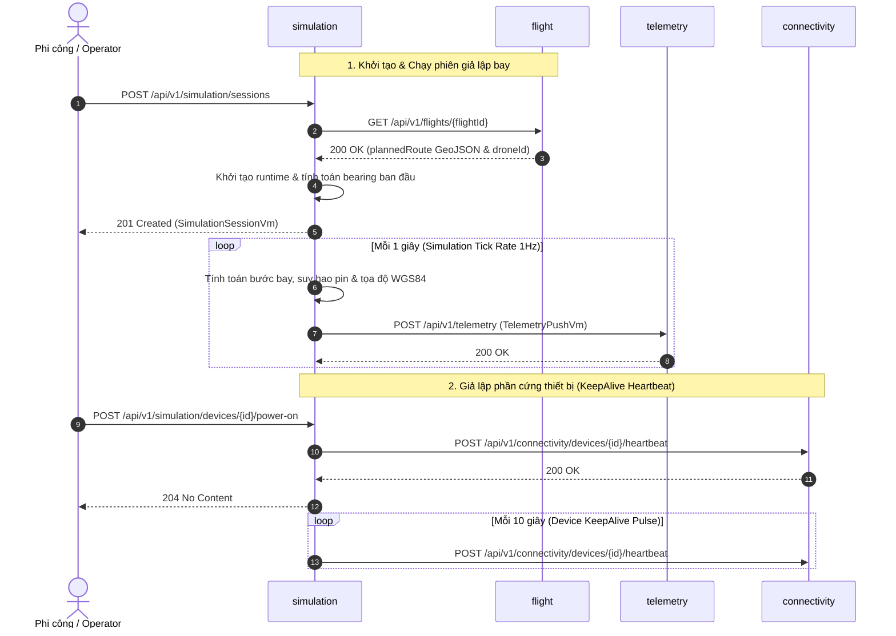

# 13. MODULE SIMULATION (Thực thể: `SimulationSession`, `SimulationEvent`)

> [← Quay lại Mục lục API](README.md) | [Quy chuẩn thiết kế chung](00-common-standards.md)

Giả lập động lực học bay 3D/4D (Kinematics & Physics), tính toán tọa độ GPS WGS84, pin, vận tốc và sinh luồng viễn trắc (Telemetry Stream) tự động phục vụ kiểm thử hệ thống UTM và diễn tập ứng phó sự cố không lưu. Cung cấp cơ chế giả lập bật/tắt nguồn phần cứng thiết bị (Virtual Device Power) và phát xung keepalive tự động tới Connectivity service.

---

## 13.1 Cấu Trúc Bảng Dữ Liệu

### 13.1.1 Bảng `simulation_session` (Phiên giả lập bay)

> **Kế thừa kiểm toán**: Kế thừa toàn bộ từ `AbstractAuditEntity` (`id`, `created_on`, `created_by`, `last_modified_on`, `last_modified_by`).

| Tên Cột DB (PostgreSQL) | Kiểu Dữ Liệu DB | Kiểu DTO | Khóa / Ràng Buộc | Ý Nghĩa Nghiệp Vụ |
| :--- | :--- | :--- | :--- | :--- |
| `id` | `varchar(36)` | `string` | **PK**, UUID, NOT NULL | Mã định danh duy nhất phiên giả lập |
| `flight_id` | `varchar(36)` | `string` | **FK** -> `flight.id`, NOT NULL | Chuyến bay được giả lập |
| `drone_id` | `varchar(50)` | `string` | **FK** -> `drone.id`, NOT NULL | Drone phần cứng ảo được điều khiển |
| `status` | `varchar(30)` | `SimulationStatus` | NOT NULL | Trạng thái phiên (`running`, `paused`, `stopped`, `completed`) |
| `speed` | `double precision` | `number` | NULLABLE | Vận tốc bay giả lập (m/s, mặc định 15.0) |
| `time_scale` | `double precision` | `number` | NULLABLE | Hệ số tua nhanh thời gian (0.1x - 20.0x, mặc định 1.0) |
| `current_lat` | `double precision` | `number` | NULLABLE | Vĩ độ hiện tại (WGS84, làm tròn 6 chữ số thập phân) |
| `current_lon` | `double precision` | `number` | NULLABLE | Kinh độ hiện tại (WGS84, làm tròn 6 chữ số thập phân) |
| `current_alt` | `double precision` | `number` | NULLABLE | Cao độ hiện tại (mét MSL, làm tròn 1 chữ số thập phân) |
| `current_heading` | `double precision` | `number` | NULLABLE | Hướng mũi bay hiện tại (0 - 360 độ) |
| `current_battery` | `double precision` | `number` | NULLABLE | Dung lượng pin hiện tại (0.0 - 100.0%) |
| `progress` | `double precision` | `number` | NULLABLE | Tiến độ hoàn thành lộ trình (0.0 - 100.0%) |
| `total_distance` | `double precision` | `number` | NULLABLE | Tổng quãng đường toàn lộ trình (mét) |
| `traveled_distance` | `double precision` | `number` | NULLABLE | Quãng đường thực tế đã bay được (mét) |
| `current_segment` | `integer` | `number` | NULLABLE | Chỉ số phân đoạn waypoint hiện tại (0-based) |
| `active_scenario` | `varchar(50)` | `string` | NULLABLE | Kịch bản sự cố khẩn cấp đang kích hoạt |

### 13.1.2 Bảng `simulation_event` (Nhật ký sự kiện diễn tập)

| Tên Cột DB (PostgreSQL) | Kiểu Dữ Liệu DB | Kiểu DTO | Khóa / Ràng Buộc | Ý Nghĩa Nghiệp Vụ |
| :--- | :--- | :--- | :--- | :--- |
| `id` | `varchar(36)` | `string` | **PK**, UUID, NOT NULL | Mã định danh sự kiện |
| `session_id` | `varchar(36)` | `string` | **FK** -> `simulation_session.id`, NOT NULL | Phiên giả lập phát sinh sự kiện |
| `event_type` | `varchar(50)` | `string` | NOT NULL | Loại sự kiện (`SESSION_PAUSED`, `SESSION_RESUMED`, `TIME_SCALE_CHANGED`, `SCENARIO_INJECTED`, `SESSION_STOPPED`, `SESSION_COMPLETED`, `BATTERY_EXHAUSTED`, `MOTOR_CRASH`) |
| `scenario` | `varchar(50)` | `string` | NULLABLE | Mã kịch bản sự cố liên quan |
| `message` | `text` | `string` | NULLABLE | Thông điệp mô tả chi tiết sự kiện |
| `severity` | `varchar(20)` | `string` | NULLABLE | Mức độ nghiêm trọng (`LOW`, `MEDIUM`, `HIGH`, `CRITICAL`) |
| `config_json` | `text` | `string` | NULLABLE | Cấu hình tham số kịch bản dưới dạng JSON |
| `created_on` | `timestamptz` | `string` | `@CreationTimestamp` | Thời điểm ghi nhận sự kiện |
| `created_by` | `varchar(255)` | `string` | NULLABLE | Người/tác nhân kích hoạt sự kiện |

---

## 13.2 Các Enum Định Nghĩa

```typescript
export type SimulationStatus = "running" | "paused" | "stopped" | "completed";

export type EmergencyScenarioType =
  | "gps_failure"      // Mất hoặc suy giảm tín hiệu định vị vệ tinh GPS
  | "battery_drain"    // Sụt giảm dung lượng pin nghiêm trọng/đột ngột
  | "c2_lost"          // Mất kết nối C2 (Command & Control) Datalink
  | "motor_failure"    // Hỏng động cơ đẩy làm mất lực nâng và rớt độ cao
  | "geofence_breach"; // Bay lệch hành lang cắt ngang vùng cấm bay
```

---

## 13.3 Chi Tiết Từng Endpoint

### 13.3.1 `POST /api/v1/simulation/sessions`
Khởi tạo và chạy phiên giả lập bay ảo từ một kế hoạch bay đã phê duyệt.

- **Chỉ định role**: `admin`, `hub_operator`, `pilot`
- **Input (Request Body)** - Model: `SimulationSessionCreateVm`:
  ```json
  {
    "flightId": "550e8400-e29b-41d4-a716-446655440000",
    "speed": 15.0,
    "timeScale": 1.0,
    "startBattery": 100.0
  }
  ```
- **Logic xử lý cốt lõi**:
  1. Validate `flightId` không rỗng.
  2. Gọi `FlightClientService.getFlightDetail(flightId)` để lấy chi tiết chuyến bay và `droneId`.
  3. Kiểm tra chặn trùng lặp: Nếu `droneId` hoặc `flightId` đã có phiên giả lập ở trạng thái `RUNNING` hoặc `PAUSED`, ném `DuplicatedException` (409 Conflict).
  4. Trích xuất danh sách Waypoint từ `flight.plannedRoute()` (GeoJSON LineString) hoặc `flight.waypoints()`. Nếu số điểm < 2 hoặc tổng quãng đường < 10m, ném `BadRequestException` (400).
  5. Tính toán heading ban đầu giữa Waypoint 0 và Waypoint 1 bằng công thức `calculateBearing`.
  6. Lưu entity `SimulationSession` vào DB với trạng thái `RUNNING`, tọa độ và cao độ tại Waypoint 0.
  7. Lấy JWT Token từ `SecurityContextHolder` (nếu có) để chuyển tiếp cho Telemetry service.
  8. Khởi tạo `SimulationSessionRuntime` trong bộ nhớ và đăng ký scheduler ảo chạy định kỳ 1 giây/tick (`scheduler.scheduleAtFixedRate(1000ms)`).
- **Phản hồi thành công**: `201 Created` - Model: `SimulationSessionVm`.

---

### 13.3.2 `GET /api/v1/simulation/sessions`
Truy vấn danh sách các phiên giả lập với bộ lọc đa tiêu chí và phân trang.

- **Chỉ định role**: Authenticated
- **Query Parameters**:
  - `status`: `SimulationStatus` (optional)
  - `droneId`: `string` (optional)
  - `flightId`: `string` (optional)
  - `search`: `string` (optional, tìm kiếm LIKE không phân biệt hoa thường theo `flightId`, `droneId`, `activeScenario`)
  - `limit`: `int` (default: 20, truyền 0 hoặc số âm để lấy toàn bộ unpaged)
  - `offset`: `int` (default: 0)
- **Logic xử lý cốt lõi**:
  - Thực thi dynamic Spring Data JPA `Specification`.
  - Đồng bộ trạng thái mới nhất từ `activeRuntimes` trong bộ nhớ RAM vào entity trước khi map sang ViewModel.
  - Sắp xếp theo `createdOn DESC`.
- **Phản hồi thành công**: `200 OK` - Model: `SimulationSessionListVm`:
  ```json
  {
    "items": [
      {
        "id": "550e8400-e29b-41d4-a716-446655440000",
        "flightId": "f1b2c3d4-e5f6-7890-abcd-ef1234567890",
        "droneId": "drone-sim-01",
        "status": "running",
        "speed": 15.0,
        "timeScale": 1.0,
        "currentLat": 10.7769,
        "currentLon": 106.7009,
        "currentAlt": 50.0,
        "currentHeading": 45.0,
        "currentBattery": 98.5,
        "progress": 42.5,
        "totalDistance": 1250.0,
        "traveledDistance": 530.0,
        "currentSegment": 1,
        "activeScenario": null,
        "createdOn": "2026-11-06T10:00:00Z",
        "lastModifiedOn": "2026-11-06T10:05:00Z"
      }
    ],
    "total": 1
  }
  ```

---

### 13.3.3 `GET /api/v1/simulation/sessions/active`
Lấy danh sách nhanh các phiên giả lập đang hoạt động (`running` hoặc `paused`).

- **Chỉ định role**: Authenticated
- **Logic xử lý**: Tìm kiếm các session có `status IN ('RUNNING', 'PAUSED')` sắp xếp theo `createdOn DESC`, đồng bộ runtime RAM và map sang VM.
- **Phản hồi thành công**: `200 OK` - Model: `List<SimulationSessionVm>`.

---

### 13.3.4 `GET /api/v1/simulation/sessions/{id}`
Lấy thông tin chi tiết, tọa độ thời gian thực, pin và tiến độ của một phiên giả lập.

- **Chỉ định role**: Authenticated
- **Phản hồi thành công**: `200 OK` - Model: `SimulationSessionVm`.
- **Lỗi nghiệp vụ**: `404 Not Found` nếu `id` không tồn tại.

---

### 13.3.5 `GET /api/v1/simulation/sessions/{id}/events`
Lấy danh sách toàn bộ các sự kiện diễn tập, sự cố và biến cố đã ghi nhận trong phiên.

- **Chỉ định role**: Authenticated
- **Logic xử lý**: Truy vấn `simulation_event` theo `sessionId` sắp xếp theo `createdOn ASC`.
- **Phản hồi thành công**: `200 OK` - Model: `List<SimulationEventVm>`.

---

### 13.3.6 `DELETE /api/v1/simulation/sessions/{id}`
Dừng hoạt động nền và xóa vĩnh viễn phiên giả lập cùng toàn bộ nhật ký sự kiện liên quan.

- **Chỉ định role**: `admin`
- **Logic xử lý**:
  1. Kiểm tra session tồn tại (404 nếu không thấy).
  2. Hủy `ScheduledFuture` trong RAM nếu đang chạy và gỡ khỏi `activeRuntimes`.
  3. Xóa các record sự kiện tương ứng trong `simulation_event`.
  4. Xóa session khỏi DB.
- **Phản hồi thành công**: `204 No Content`.

---

### 13.3.7 `PATCH /api/v1/simulation/sessions/{id}/pause`
Tạm dừng quá trình bay và phát luồng viễn trắc.

- **Chỉ định role**: `admin`, `hub_operator`, `pilot`
- **Logic xử lý**:
  1. Kiểm tra trạng thái: Phải đang là `running` (nếu đã `paused` hoặc trạng thái khác $\rightarrow$ ném `BadRequestException` 400).
  2. Chuyển runtime trạng thái sang `PAUSED`.
  3. Lưu `status = PAUSED` vào DB.
  4. Ghi sự kiện `SESSION_PAUSED` vào `simulation_event`.
- **Phản hồi thành công**: `200 OK` - Model: `SimulationSessionVm`.

---

### 13.3.8 `PATCH /api/v1/simulation/sessions/{id}/resume`
Tiếp tục phiên giả lập đang tạm dừng.

- **Chỉ định role**: `admin`, `hub_operator`, `pilot`
- **Logic xử lý**:
  1. Kiểm tra trạng thái: Phải đang là `paused` (nếu đã `running` hoặc trạng thái khác $\rightarrow$ ném `BadRequestException` 400).
  2. Kiểm tra runtime trong RAM tồn tại.
  3. Chuyển runtime trạng thái sang `RUNNING`.
  4. Lưu `status = RUNNING` vào DB.
  5. Ghi sự kiện `SESSION_RESUMED` vào `simulation_event`.
- **Phản hồi thành công**: `200 OK` - Model: `SimulationSessionVm`.

---

### 13.3.9 `PATCH /api/v1/simulation/sessions/{id}/time-scale`
Điều chỉnh linh hoạt tốc độ tua thời gian của phiên giả lập.

- **Chỉ định role**: `admin`, `hub_operator`, `pilot`
- **Input (Request Body)** - Model: `TimeScaleUpdateVm`:
  ```json
  {
    "timeScale": 5.0
  }
  ```
  *(Ràng buộc: `0.1 <= timeScale <= 20.0`)*
- **Logic xử lý**:
  1. Kiểm tra session đang `running` hoặc `paused`.
  2. Cập nhật `timeScale` trong runtime RAM và database.
  3. Ghi sự kiện `TIME_SCALE_CHANGED` vào `simulation_event`.
- **Phản hồi thành công**: `200 OK` - Model: `SimulationSessionVm`.

---

### 13.3.10 `POST /api/v1/simulation/sessions/{id}/inject-scenario`
Bơm kịch bản sự cố khẩn cấp vào phiên bay trực tiếp để kiểm thử phản ứng UTM.

- **Chỉ định role**: `admin`, `atc`, `pilot`
- **Input (Request Body)** - Model: `InjectScenarioVm`:
  ```json
  {
    "scenario": "battery_drain",
    "config": {
      "dischargeRatePerSecond": 5.0,
      "targetRemainingPercent": 10.0
    }
  }
  ```
- **Hành vi động lực học của từng kịch bản sự cố**:
  - `gps_failure`: Thêm độ lệch ngẫu nhiên `(Math.random() - 0.5) * 0.001` độ vào tọa độ GPS gửi đi nhằm kích hoạt cảnh báo mất tín hiệu GPS.
  - `battery_drain`: Xả pin nhanh với tốc độ 5.0%/giây (thay vì 0.033%/giây bình thường). Khi pin <= 5%, drone tự động giảm độ cao 3.0 m/s để hạ cánh bắt buộc; khi pin = 0% hoặc chạm đất, dừng giả lập và kích hoạt sự kiện `BATTERY_EXHAUSTED`.
  - `c2_lost`: Cắt đứt luồng phát viễn trắc sang Telemetry Service (`sendTelemetry = false`) để kiểm tra phát hiện timeout mất liên lạc C2.
  - `motor_failure`: Giảm tốc độ còn 80%, giảm cao độ 8.0 m/s. Khi chạm đất (`currentAlt <= 0`), dừng phiên và ghi sự kiện `MOTOR_CRASH`.
  - `geofence_breach`: Dịch chuyển tọa độ vuông góc với đường bay 75m (`driftDist = 75.0m`) để drone cắt ngang ranh giới không lưu/vùng cấm bay.
- **Phản hồi thành công**: `200 OK` - Model: `InjectScenarioResultVm`:
  ```json
  {
    "success": true,
    "event": {
      "id": "e1b2c3d4-e5f6-7890-abcd-ef1234567890",
      "type": "SCENARIO_INJECTED",
      "scenario": "battery_drain",
      "message": "Injected emergency scenario 'Critical Battery Drain' (Rapid depletion of battery capacity due to cell malfunction or thermal overload.)",
      "severity": "CRITICAL",
      "createdOn": "2026-11-06T10:12:00Z"
    }
  }
  ```

---

### 13.3.11 `POST /api/v1/simulation/sessions/{id}/stop`
Dừng hoàn toàn phiên giả lập.

- **Chỉ định role**: `admin`, `hub_operator`, `pilot`
- **Logic xử lý**:
  1. Kiểm tra session chưa bị `stopped` hoặc `completed` (400 nếu vi phạm).
  2. Hủy `ScheduledFuture` trong RAM, gỡ khỏi `activeRuntimes`.
  3. Cập nhật `status = STOPPED` vào DB.
  4. Ghi sự kiện `SESSION_STOPPED` vào `simulation_event`.
- **Phản hồi thành công**: `200 OK` - Model: `SimulationSessionVm`.

---

### 13.3.12 `GET /api/v1/simulation/scenarios`
Lấy danh mục các kịch bản sự cố khẩn cấp được hỗ trợ cùng tài liệu mô tả và danh sách tham số cấu hình.

- **Chỉ định role**: Authenticated
- **Phản hồi thành công**: `200 OK` - Model: `List<ScenarioCatalogVm>`:
  ```json
  [
    {
      "type": "gps_failure",
      "name": "GPS Signal Failure",
      "description": "Sudden loss or degradation of GPS positioning signal, resulting in coordinate drift or complete signal loss.",
      "severity": "HIGH",
      "parameters": ["driftDistanceMeters", "lossDurationSeconds"]
    },
    {
      "type": "battery_drain",
      "name": "Critical Battery Drain",
      "description": "Rapid depletion of battery capacity due to cell malfunction or thermal overload.",
      "severity": "CRITICAL",
      "parameters": ["dischargeRatePerSecond", "targetRemainingPercent"]
    },
    {
      "type": "c2_lost",
      "name": "Command & Control Link Lost",
      "description": "Loss of Command & Control (C2) communication link between the drone and Ground Control Station (GCS).",
      "severity": "HIGH",
      "parameters": ["reconnectionTimeoutSeconds", "failsafeAction"]
    },
    {
      "type": "motor_failure",
      "name": "Motor Failure",
      "description": "Propulsion or rotor malfunction causing loss of lift control and altitude drop.",
      "severity": "CRITICAL",
      "parameters": ["failedMotorIndex", "descentRateMps"]
    },
    {
      "type": "geofence_breach",
      "name": "Geofence Breach",
      "description": "Drone deviates from authorized flight corridor and encroaches into restricted or prohibited airspace.",
      "severity": "HIGH",
      "parameters": ["breachZoneId", "deviationMeters"]
    }
  ]
  ```

---

### 13.3.13 `POST /api/v1/simulation/devices/{id}/power-on`
Giả lập bật công tắc nguồn phần cứng của thiết bị (Drone/GCS/Sensor/Tracking Unit) và bắt đầu phát xung keepalive tự động.

- **Chỉ định role**: `admin`, `hub_operator`, `pilot`
- **Logic xử lý**:
  1. Kiểm tra `id` không rỗng (400 nếu rỗng).
  2. Gửi ngay một nhịp heartbeat đầu tiên qua `ConnectivityClientService.sendHeartbeat(id)`. Nếu trả về `false`, ném `BadRequestException`.
  3. Thêm thiết bị vào `activeDeviceIds` (thread-safe ConcurrentHashMap set).
  4. Scheduler nền sẽ tự động gửi xung heartbeat mỗi 10 giây (`tickKeepAlive`).
- **Phản hồi thành công**: `204 No Content`.

---

### 13.3.14 `POST /api/v1/simulation/devices/{id}/power-off`
Giả lập tắt nguồn phần cứng thiết bị và ngừng phát xung keepalive.

- **Chỉ định role**: `admin`, `hub_operator`, `pilot`
- **Logic xử lý**:
  1. Kiểm tra `id` không rỗng (400 nếu rỗng).
  2. Xóa thiết bị khỏi `activeDeviceIds`.
  3. Thiết bị sẽ tự động chuyển sang trạng thái `OFFLINE` trong `connectivity` service sau 30 giây timeout.
- **Phản hồi thành công**: `204 No Content`.

---

## 13.4 Luồng Tích Hợp Giữa Các Microservice (Inter-Service Integration)


