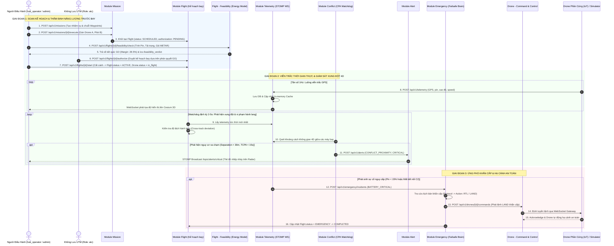

# 14. QUY TRÌNH TÍCH HỢP LIÊN DỊCH VỤ TOÀN HỆ THỐNG (END-TO-END WORKFLOWS)

> [← Quay lại Mục lục API](README.md) | [Quy chuẩn thiết kế chung](00-common-standards.md)

Sơ đồ tuần tự và luồng nghiệp vụ phối hợp liên dịch vụ (E2E Integration Orchestration) giữa Người điều hành bãi, Kiểm soát viên không lưu (ATC), Phi công và các microservices nghiệp vụ: Từ lập nhiệm vụ $\rightarrow$ Thẩm định năng lượng vật lý $\rightarrow$ Phê duyệt bay $\rightarrow$ Giám sát viễn trắc thời gian thực $\rightarrow$ Phát hiện xung đột 4D $\rightarrow$ Kích hoạt cảnh báo $\rightarrow$ Hệ thống tự động cứu nạn (Failsafe Brain).

---

## 14.1 Sơ Đồ Tuần Tự Toàn Trình (Master Sequence Diagram)

---

## 14.2 Ma Trận Quyền Hạn & Trách Nhiệm (RACI Matrix)

| Giai đoạn nghiệp vụ | Role: `admin` | Role: `hub_operator` | Role: `pilot` | Role: `atc` |
| :--- | :---: | :---: | :---: | :---: |
| **Đăng ký tổ chức, Hub, Vùng cấm bay** | **A / R** | I | I | C |
| **Đăng ký Drone, Gán thiết bị IoT** | A | **R** | C | I |
| **Lập nhiệm vụ (Mission) & Tạo Flight** | A | **R** | **R** | I |
| **Thẩm định năng lượng trước bay (Feasibility)** | I | **R** | **R** | C |
| **Cấp phép bay (Flight Authorization)** | I | I | I | **A / R** |
| **Kích hoạt cất cánh (Start Flight)** | I | **R** | **R** | I |
| **Giải tỏa xung đột không gian (Deconfliction)** | I | I | C | **A / R** |
| **Phê chuẩn can thiệp cứu nạn khẩn cấp** | A | C | **R** | **A / R** |

*(Chú thích: **A**: Accountable - Chịu trách nhiệm tối cao; **R**: Responsible - Người trực tiếp thực thi; **C**: Consulted - Tham vấn ý kiến; **I**: Informed - Được nhận thông báo)*

