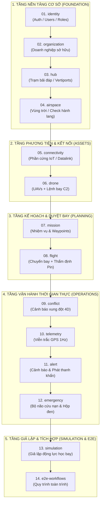

# DROPS-UTM: ĐẶC TẢ CHI TIẾT API & LỘ TRÌNH PHÁT TRIỂN SERVICE-FIRST

> **Tài liệu chuẩn kiến trúc**: Hệ thống tài liệu đặc tả chuẩn hóa 1-1 theo từng Microservice độc lập trong hệ sinh thái **DROPS-UTM**.  
> **Kiến trúc công nghệ backend**: Java 21 + Spring Boot (Spring Data JPA, RestClient) + PostgreSQL (PostGIS) + Keycloak OAuth2/JWT + STOMP WebSocket Gateway.

---

## ⭐️ QUY CHUẨN KỸ THUẬT DÙNG CHUNG
- **[00. Quy chuẩn Thiết kế Chung (Common Standards & Audit Entity)](00-common-standards.md)**: Định nghĩa lớp trừu tượng `AbstractAuditEntity` (`id`, `createdOn`, `createdBy`, `lastModifiedOn`, `lastModifiedBy`), quy chuẩn phân trang (`items`, `total`), và chuẩn phản hồi lỗi (`ErrorVm`).

---

## 🚀 LỘ TRÌNH REFACTOR & DANH MỤC MICROSERVICE (SERVICE-FIRST ROADMAP)

Các tài liệu dưới đây được sắp xếp theo đúng **thứ tự phụ thuộc (Dependency Order)**. Khi bàn giao cho Agent hoặc Developer refactor/viết Unit Test, hãy thực hiện tuần tự theo thứ tự từ **01 đến 13**:

---

### Bảng Danh Mục Đặc Tả Chi Tiết

| Thứ tự | Tài liệu Đặc tả | Microservice phụ trách | Mô tả chức năng & Thực thể quản lý |
| :---: | :--- | :--- | :--- |
| **01** | [**01-identity.md**](01-identity.md) | `identity` | Đăng ký, đăng nhập JWT, phân quyền RBAC (`admin`, `hub_operator`, `pilot`, `atc`), quản lý hồ sơ phi công (`User`). |
| **02** | [**02-organization.md**](02-organization.md) | `organization` | Đơn vị vận hành, cơ quan quản lý, khách hàng doanh nghiệp (`Organization`). |
| **03** | [**03-hub.md**](03-hub.md) | `hub` | Trạm cất/hạ cánh, Vertiports, bán kính đệm bảo vệ an toàn trạm (`Hub`). |
| **04** | [**04-airspace.md**](04-airspace.md) | `airspace` | Vùng cấm bay (NFZ), hành lang tiếp cận, thuật toán kiểm tra va chạm đa giác GeoJSON (`AirspaceZone`). |
| **05** | [**05-connectivity.md**](05-connectivity.md) | `connectivity` | Đăng ký định danh phần cứng bay (IMEI/MAC), nhịp tim heartbeat, phiên WebSocket Gateway (`DeviceRegistration`). |
| **06** | [**06-drone.md**](06-drone.md) | `drone` | **GOM CHUẨN**: Hồ sơ phương tiện bay (`Drone`) + Lệnh điều khiển chiến thuật thời gian thực C2/GCS (`DroneCommand`). |
| **07** | [**07-mission.md**](07-mission.md) | `mission` | Kế hoạch nhiệm vụ bay nghiệp vụ, chuỗi tọa độ mốc 3D (`Mission`, `Waypoint`). |
| **08** | [**08-flight.md**](08-flight.md) | `flight` | **GOM CHUẨN**: Quản lý vòng đời chuyến bay (`Flight`), giám sát hành lang 4D (`FlightConformance`) + Thẩm định năng lượng vật lý trước bay (`FeasibilityEvaluation`). |
| **09** | [**09-conflict.md**](09-conflict.md) | `conflict` | Giám sát & giải tỏa xung đột va chạm không gian 4D, hộp đen chụp ảnh xung đột (`Conflict`, `ConflictSnapshot`). |
| **10** | [**10-telemetry.md**](10-telemetry.md) | `telemetry` | Tiếp nhận chuỗi thời gian viễn trắc GPS 1Hz, phát sóng STOMP WebSocket tới Radar và Cesium 3D (`TelemetryRecord`). |
| **11** | [**11-alert.md**](11-alert.md) | `alert` | Tiếp nhận, phân loại mức độ rủi ro, quản lý vòng đời cảnh báo và phát sóng khẩn cấp (`Alert`). |
| **12** | [**12-emergency.md**](12-emergency.md) | `emergency` | Bộ não an toàn thời gian thực, ma trận kịch bản cứu hộ (`LAND`, `RTL`) và hộp đen tần số cao (`EmergencyIncident`, `BlackboxEntry`). |
| **13** | [**13-simulation.md**](13-simulation.md) | `simulation` | Giả lập động lực học bay 3D/4D, sinh viễn trắc tự động theo kịch bản sự cố (`SimulationSession`). |
| **14** | [**14-e2e-workflows.md**](14-e2e-workflows.md) | *(Toàn hệ thống)* | Sơ đồ tuần tự tích hợp E2E toàn trình và Ma trận phân định trách nhiệm RACI Matrix. |
