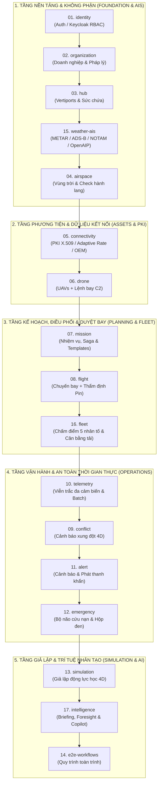

# DROPS-UTM: ĐẶC TẢ CHI TIẾT API & LỘ TRÌNH PHÁT TRIỂN SERVICE-FIRST

> **Tài liệu chuẩn kiến trúc**: Hệ thống tài liệu đặc tả chuẩn hóa 1-1 theo từng Microservice độc lập trong hệ sinh thái **DROPS-UTM**.  
> **Kiến trúc công nghệ backend**: Java 21 + Spring Boot (Spring Data JPA, RestClient) + PostgreSQL (PostGIS) + Keycloak OAuth2/JWT + STOMP WebSocket Gateway.

---

## ⭐️ QUY CHUẨN KỸ THUẬT DÙNG CHUNG
- **[00. Quy chuẩn Thiết kế Chung (Common Standards & Audit Entity)](00-common-standards.md)**: Định nghĩa lớp trừu tượng `AbstractAuditEntity` (`id`, `createdOn`, `createdBy`, `lastModifiedOn`, `lastModifiedBy`), quy chuẩn phân trang (`items`, `total`), và chuẩn phản hồi lỗi (`ErrorVm`).

---

## 🚀 LỘ TRÌNH REFACTOR & DANH MỤC MICROSERVICE (SERVICE-FIRST ROADMAP)

Các tài liệu dưới đây được sắp xếp theo đúng **thứ tự phụ thuộc (Dependency Order)** của 15 domain microservices trong hệ sinh thái DROPS-UTM:

---

### Bảng Danh Mục Đặc Tả Chi Tiết

| Thứ tự | Tài liệu Đặc tả | Microservice phụ trách | Mô tả chức năng & Thực thể quản lý |
| :---: | :--- | :--- | :--- |
| **01** | [**01-identity.md**](01-identity.md) | `identity` | Đăng nhập OAuth2/OIDC Keycloak, BFF Session, phân quyền RBAC (`admin`, `hub_operator`, `pilot`, `atc`). |
| **02** | [**02-organization.md**](02-organization.md) | `organization` | Đơn vị vận hành, đối tác, cơ quan quản lý, chứng chỉ & bảo hiểm hàng không (`Organization`). |
| **03** | [**03-hub.md**](03-hub.md) | `hub` | Trạm cất/hạ cánh, Vertiports, năng lực hạ tầng sạc và trạng thái vận hành tức thời (`Hub`). |
| **04** | [**04-airspace.md**](04-airspace.md) | `airspace` | Vùng cấm bay, hành lang, quy tắc/lịch hoạt động JSONB & kiểm tra va chạm hợp nhất OpenAIP (`AirspaceZone`). |
| **05** | [**05-connectivity.md**](05-connectivity.md) | `connectivity` | Định danh thiết bị (`DRONE`/`GATEWAY`/`GCS`), chứng thư PKI X.509, Adaptive Telemetry Rate & cổng OEM (`X-API-Key`). |
| **06** | [**06-drone.md**](06-drone.md) | `drone` | Hồ sơ UAV, năng lực cảm biến, lịch bảo dưỡng (`Drone`) + Lệnh điều khiển chiến thuật C2/GCS (`DroneCommand`). |
| **07** | [**07-mission.md**](07-mission.md) | `mission` | Kế hoạch nhiệm vụ, chuỗi mốc 3D, Multi-Leg Execution Saga & Thư viện mẫu nhiệm vụ có phiên bản (`MissionTemplate`). |
| **08** | [**08-flight.md**](08-flight.md) | `flight` | Vòng đời chuyến bay (`Flight`), chụp thời tiết khi duyệt, giám sát hành lang 4D & Thẩm định năng lượng vật lý / AI. |
| **09** | [**09-conflict.md**](09-conflict.md) | `conflict` | Giám sát & giải tỏa xung đột không gian 4D (kể cả vận tốc thẳng đứng `verticalSpeed`), hộp đen snapshot (`Conflict`). |
| **10** | [**10-telemetry.md**](10-telemetry.md) | `telemetry` | Tiếp nhận viễn trắc đơn lẻ & theo lô (`batch`), cảm biến mở rộng (AGL, điện áp, nhiệt độ, HDOP, RPM) & STOMP live. |
| **11** | [**11-alert.md**](11-alert.md) | `alert` | Phân loại mức độ rủi ro mở rộng, quản lý vòng đời cảnh báo và phát sóng khẩn cấp (`Alert`). |
| **12** | [**12-emergency.md**](12-emergency.md) | `emergency` | Phát hiện đa cảm biến tự động, kịch bản cứu hộ ưu tiên `P0` qua Kafka & hộp đen tần số cao (`EmergencyIncident`). |
| **13** | [**13-simulation.md**](13-simulation.md) | `simulation` | Giả lập động lực học 4D khởi tạo từ `flightId`, `missionId` hoặc chuỗi `waypoints` tùy chỉnh (`SimulationSession`). |
| **14** | [**14-e2e-workflows.md**](14-e2e-workflows.md) | *(Toàn hệ thống)* | Sơ đồ tuần tự tích hợp E2E toàn trình và Ma trận phân định trách nhiệm RACI Matrix. |
| **15** | [**15-weather-ais.md**](15-weather-ais.md) | `weather-ais` | Khí tượng METAR/TAF/SIGMET, phán quyết Go/No-Go theo Hub, ADS-B, NOTAM, OpenAIP & WMS DAGR Việt Nam. |
| **16** | [**16-fleet.md**](16-fleet.md) | `fleet` | Chấm điểm phân công Drone 5 nhân tố (`FleetAssignment`), cấu hình preset & điều động cân bằng tải liên Hub (`RebalancingTask`). |
| **17** | [**17-intelligence.md**](17-intelligence.md) | `intelligence` | Pre-Flight Briefing đa nguồn, dự báo xung đột sớm Airspace Foresight & trợ lý hội thoại Operator Copilot. |
