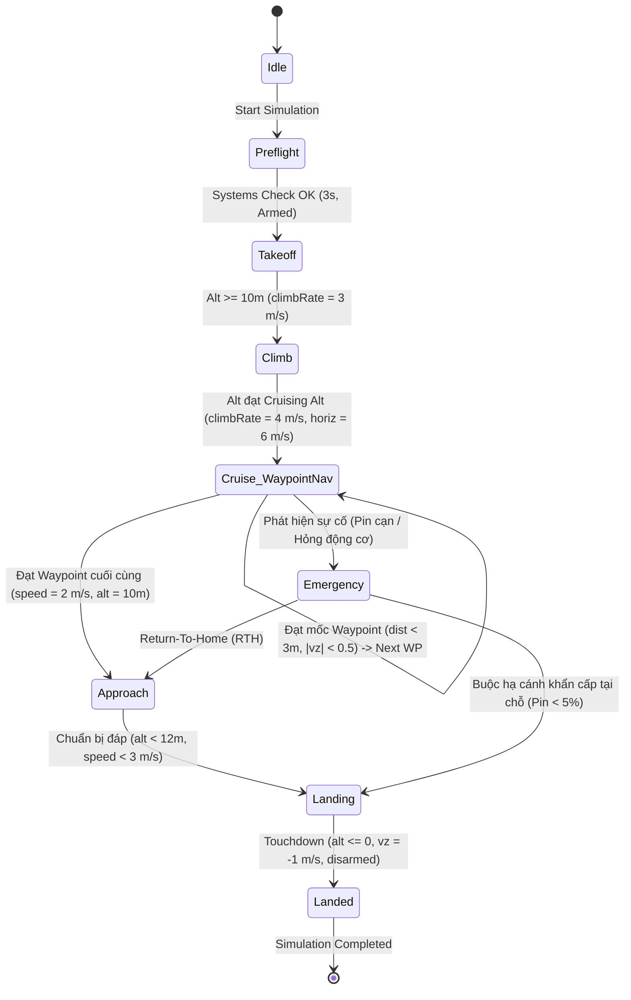
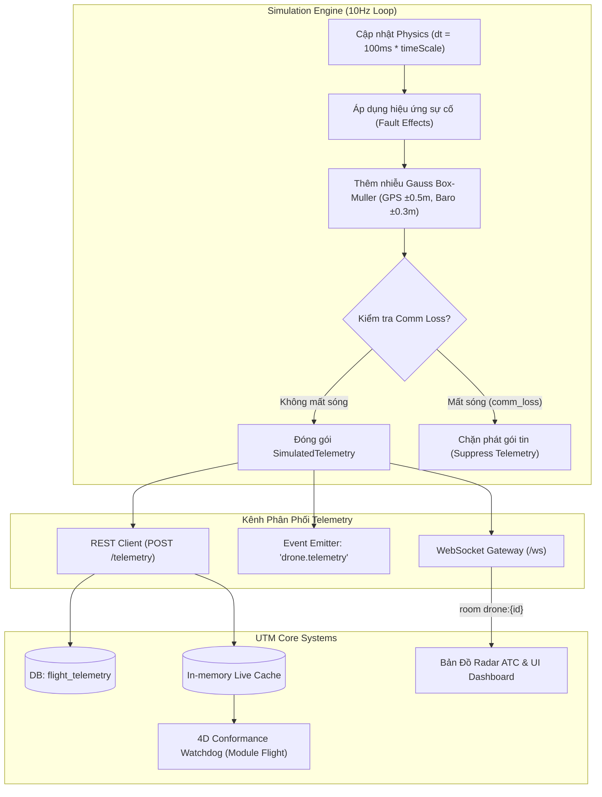
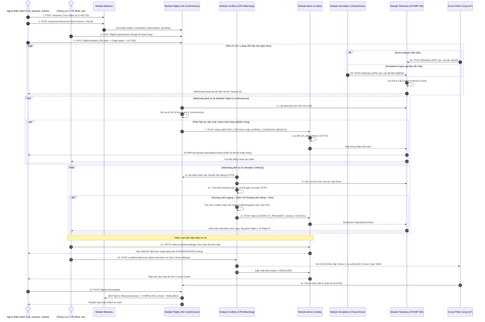

# DROPS-UTM: ĐẶC TẢ CHI TIẾT THỰC THỂ, DỮ LIỆU & LOGIC ENDPOINTS (12 THỰC THỂ CORE)

> **Tài liệu tham chiếu chuẩn theo Sơ đồ ERD tối ưu**: [erd_chen_optimal.drawio](file:///d:/workspace/utm/Drops-UTM/docs/erd_chen_optimal.drawio)  
> **Kiến trúc công nghệ backend**: NestJS + TypeORM + PostgreSQL (PostGIS) + WebSocket Gateway  
> **Quy ước phân quyền (RBAC)**:  
> - Các endpoint thông thường (bất kỳ ai đã đăng nhập đều thao tác được) hoặc công khai (`@Public()`) sẽ **không ghi chú role** để tài liệu gọn gàng và dễ theo dõi.  
> - Các endpoint **chỉ định cụ thể vai trò được phép truy cập** sẽ được ghi chú rõ ràng dòng: `* **Chỉ định role**: [role_names]`.  
> - Hệ thống có 4 vai trò chính: `admin` (Quản trị viên tối cao), `hub_operator` (Người điều hành trạm/kho), `pilot` (Phi công phụ trách bay), `atc` (Kiểm soát viên không lưu).

---

## MỤC LỤC TỔNG QUAN

1. [Module 1: Organizations (Thực thể `Organization`)](#1-module-organizations-thực-thể-organization)
2. [Module 2: Auth & Users (Thực thể `User`)](#2-module-auth--users-thực-thể-user)
3. [Module 3: Hubs (Thực thể `Hub`)](#3-module-hubs-thực-thể-hub)
4. [Module 4: Airspace (Thực thể `AirspaceZone`)](#4-module-airspace-thực-thể-airspacezone)
5. [Module 5: Connectivity (Thực thể `DeviceRegistration` - Rút gọn cơ bản)](#5-module-connectivity-thực-thể-deviceregistration)
6. [Module 6: Drones (Thực thể `Drone`)](#6-module-drones-thực-thể-drone)
7. [Module 7: Missions & Waypoints (Thực thể `Mission`, `Waypoint`)](#7-module-missions--waypoints-thực-thể-mission--waypoint)
8. [Module 8: Flights & Executions (Thực thể `Flight`, `MissionExecution`)](#8-module-flights--executions-thực-thể-flight--missionexecution)
9. [Module 9: Conflicts (Thực thể `Conflict`, `ConflictSnapshot`)](#9-module-conflicts-thực-thể-conflict)
10. [Module 10: Telemetry (Thực thể `FlightTelemetry`)](#10-module-telemetry-thực-thể-flighttelemetry)
11. [Module 11: Simulation & Telemetry Generator (Thực thể `SimulationSession`)](#11-module-simulation--telemetry-generator-thực-thể-simulationsession)
12. [Module 12: Alerts & Operational Safety (Thực thể `Alert`)](#12-module-alerts--operational-safety-thực-thể-alert)
13. [Sơ Đồ Tuần Tự Toàn Trình (End-to-End Sequence)](#13-sơ-đồ-tuần-tự-toàn-trình)

---

## 1. MODULE ORGANIZATIONS (Thực thể: `Organization`)

Quản lý doanh nghiệp hoặc cơ quan khai thác hệ thống trong mô hình Multi-tenancy.

### 1.1 Cấu Trúc Bảng Dữ Liệu (`organizations`)

| Tên Cột (DB Column) | Kiểu Dữ Liệu DB | Kiểu TypeScript | Khóa / Ràng Buộc | Ý Nghĩa Nghiệp Vụ |
| :--- | :--- | :--- | :--- | :--- |
| `id` | `uuid` | `string` | **PK**, Default: `uuid_generate_v4()` | Định danh duy nhất của tổ chức |
| `name` | `varchar(255)` | `string` | NOT NULL | Tên công ty / đơn vị vận hành |
| `type` | `varchar(50)` | `OrganizationType` | NOT NULL | Phân loại tổ chức |
| `registration_number` | `varchar(100)` | `string` | NOT NULL, **UNIQUE** | Mã số đăng ký kinh doanh / Giấy phép bay |
| `contact_info` | `text` | `string` | NULLABLE | Email, số điện thoại, thông tin liên lạc |
| `status` | `varchar(50)` | `OrganizationStatus` | NOT NULL, Default: `'active'` | Trạng thái hoạt động |
| `created_at` | `timestamptz` | `Date` | NOT NULL, Default: `now()` | Thời điểm tạo bản ghi |

### 1.2 Các Enum

```typescript
export type OrganizationType = 'operator' | 'authority' | 'enterprise';
// 'operator': Doanh nghiệp vận hành bay / giao vận drone
// 'authority': Cơ quan quản lý nhà nước / Cục hàng không / Quản lý không lưu
// 'enterprise': Khách hàng doanh nghiệp lớn thuê dịch vụ giao vận

export type OrganizationStatus = 'active' | 'suspended' | 'inactive';
// 'active': Hoạt động bình thường
// 'suspended': Bị tạm đình chỉ bay (do vi phạm an toàn hoặc chờ thanh toán)
// 'inactive': Đã ngừng hoạt động / giải thể
```

### 1.3 Mối Quan Hệ Liên Kết (Relationships)
* **`User` (1 - N)**: Một Organization có nhiều nhân viên / người dùng (`organization.users -> user.organizationId`).
* **`Drone` (1 - N)**: Một Organization sở hữu nhiều máy bay không người lái (`organization.drones -> drone.ownerId`).

### 1.4 Chi Tiết Từng Endpoint

#### 1.4.1 `POST /organizations`
* **Chỉ định role**: `admin`
* **Input (Body)**:
  ```json
  {
    "name": "Công ty Cổ phần Vận tải Drone Express",
    "type": "operator",
    "registrationNumber": "GP-2026-DK01",
    "contactInfo": "contact@droneexpress.vn"
  }
  ```
* **Logic xử lý chi tiết**:
  1. **Validation**: Kiểm tra `name` không được để trống; `type` phải thuộc enum `OrganizationType`; `registrationNumber` không được để trống.
  2. **Check Unique**: Truy vấn bảng `organizations` kiểm tra `registration_number`. Nếu đã tồn tại -> Ném lỗi `409 ConflictException('Registration number already registered')`.
  3. **Tạo bản ghi**: Gán `status = 'active'`, tự động sinh `id` (UUID v4) và `created_at = now()`.
  4. **Lưu DB**: Thực hiện lưu bản ghi vào bảng `organizations`.
* **Output**: `201 Created` -> Trả về object `Organization` vừa tạo.

#### 1.4.2 `GET /organizations`
* **Input (Query)**: `?type=operator&status=active&search=Express&limit=10&offset=0`
* **Logic xử lý chi tiết**:
  1. Trích xuất query params: `type`, `status`, `search` (tên công ty hoặc mã GP), `limit` (mặc định 20), `offset` (mặc định 0).
  2. Xây dựng câu truy vấn `TypeORM SelectQueryBuilder`:
     - Nếu có `search`: thêm điều kiện `(name ILIKE :search OR registration_number ILIKE :search)`.
     - Nếu có `type`: thêm điều kiện `type = :type`.
     - Nếu có `status`: thêm điều kiện `status = :status`.
  3. Sử dụng `getManyAndCount()` để lấy danh sách bản ghi và tổng số lượng.
* **Output**: `200 OK` -> `{ "items": Organization[], "total": number }`.

#### 1.4.3 `GET /organizations/:id`
* **Input (Params)**: `id: UUID`
* **Logic xử lý chi tiết**:
  1. Validate định dạng UUID của `id`.
  2. Truy vấn bảng `organizations` theo `id`. Đồng thời load thống kê số lượng drone (`dronesCount`) và số người dùng (`usersCount`).
  3. Nếu không tìm thấy bản ghi -> Ném lỗi `404 NotFoundException('Organization not found')`.
* **Output**: `200 OK` -> `Organization` kèm thống kê tài nguyên.

#### 1.4.4 `PUT /organizations/:id`
* **Chỉ định role**: `admin`
* **Input (Params + Body)**:
  - `id: UUID`
  - Body:
    ```json
    {
      "name": "Công ty Cổ phần Vận tải Drone Express Việt Nam",
      "contactInfo": "hotline@droneexpress.vn",
      "status": "active"
    }
    ```
* **Logic xử lý chi tiết**:
  1. Tìm kiếm tổ chức theo `id`. Nếu không tồn tại -> Ném lỗi `404 NotFoundException`.
  2. Chặn không cho sửa đổi các trường cố định: `id`, `registration_number`.
  3. Cập nhật các trường được truyền lên: `name`, `contact_info`, `type`, `status`.
  4. Lưu lại bản ghi vào DB.
* **Output**: `200 OK` -> `Organization` sau khi cập nhật.

#### 1.4.5 `DELETE /organizations/:id`
* **Chỉ định role**: `admin`
* **Input (Params)**: `id: UUID`
* **Logic xử lý chi tiết**:
  1. Tìm kiếm tổ chức theo `id`. Nếu không tồn tại -> Ném lỗi `404 NotFoundException`.
  2. **Kiểm tra ràng buộc nghiệp vụ an toàn**: Truy vấn bảng `drones` và `flights` xem tổ chức này có máy bay nào đang bay trên không (`status = 'in_flight'`) hay không. Nếu có -> Ném lỗi `400 BadRequestException('Cannot deactivate organization with drones currently in flight')`.
  3. **Thực hiện Soft-delete**: Cập nhật `status = 'inactive'`.
* **Output**: `200 OK` -> `{ "message": "Organization deactivated successfully" }`.

---

## 2. MODULE AUTH & USERS (Thực thể: `User`)

Quản lý đăng ký, đăng nhập, JWT Token, phân quyền người dùng và cấp chứng chỉ phi công.

### 2.1 Cấu Trúc Bảng Dữ Liệu (`users`)

| Tên Cột | Kiểu Dữ Liệu DB | Kiểu TypeScript | Khóa / Ràng Buộc | Ý Nghĩa Nghiệp Vụ |
| :--- | :--- | :--- | :--- | :--- |
| `id` | `uuid` | `string` | **PK**, Default: `uuid()` | Định danh người dùng |
| `email` | `varchar(255)` | `string` | NOT NULL, **UNIQUE** | Email đăng nhập |
| `password_hash` | `varchar(255)` | `string` | NOT NULL | Mật khẩu băm (bcrypt) |
| `first_name` | `varchar(100)` | `string` | NULLABLE | Tên |
| `last_name` | `varchar(100)` | `string` | NULLABLE | Họ và tên đệm |
| `role` | `varchar(50)` | `UserRole` | NOT NULL, Default: `'operator'` | Vai trò trong hệ thống |
| `organization_id` | `uuid` | `string` | **FK** -> `organizations.id` | Trực thuộc tổ chức nào |
| `pilot_license` | `varchar(100)` | `string` | NULLABLE | Số hiệu bằng lái phi công drone |
| `status` | `varchar(50)` | `UserStatus` | NOT NULL, Default: `'active'` | Trạng thái tài khoản |

### 2.2 Các Enum

```typescript
export type UserRole = 'admin' | 'hub_operator' | 'pilot' | 'atc';
// 'admin': Quản trị viên hệ thống tối cao
// 'hub_operator': Người điều hành tại Hub / Bãi đáp
// 'pilot': Phi công điều khiển / giám sát chuyến bay
// 'atc': Nhân viên kiểm soát không lưu (có quyền duyệt cấp phép bay)

export type UserStatus = 'active' | 'inactive' | 'suspended';
```

### 2.3 Mối Quan Hệ Liên Kết (Relationships)
* **`Organization` (N - 1)**: Thuộc về 1 Organization (`user.organizationId -> organization.id`).
* **`Mission` (1 - N)**: Người tạo nhiệm vụ (`mission.createdBy -> user.id`).
* **`Flight` (1 - N)**: Phi công phụ trách chuyến bay (`flight.pilotId -> user.id`).

### 2.4 Chi Tiết Từng Endpoint

#### 2.4.1 `POST /auth/register`
* **Ghi chú**: Công khai (`@Public()`), không yêu cầu token đăng nhập.
* **Input (Body)**:
  ```json
  {
    "email": "pilot.nam@droneexpress.vn",
    "password": "SecurePassword123@",
    "firstName": "Nam",
    "lastName": "Nguyễn",
    "role": "pilot",
    "organizationId": "a1b2c3d4-e5f6-7890-abcd-ef1234567890",
    "pilotLicense": "PL-VN-2026-88"
  }
  ```
* **Logic xử lý chi tiết**:
  1. **Validation**: Kiểm tra tính hợp lệ của email; mật khẩu tối thiểu 8 ký tự bao gồm chữ hoa, số và ký tự đặc biệt.
  2. **Check Unique**: Truy vấn bảng `users` theo `email`. Nếu đã tồn tại -> Ném lỗi `409 ConflictException('Email already registered')`.
  3. **Kiểm tra Organization**: Truy vấn bảng `organizations` theo `organizationId`. Nếu không tồn tại hoặc `status != 'active'` -> Ném lỗi `400 BadRequestException('Invalid or inactive organization')`.
  4. **Kiểm tra Pilot License**: Nếu `role == 'pilot'`, kiểm tra trường `pilotLicense` không được để trống.
  5. **Băm mật khẩu**: Sử dụng `bcrypt.hash(password, 10)`.
  6. **Lưu bản ghi**: Tạo `User` với `status = 'active'`. Loại bỏ trường `password_hash` trước khi trả về.
* **Output**: `201 Created` -> Trả về thông tin User mới tạo.

#### 2.4.2 `POST /auth/login`
* **Ghi chú**: Công khai (`@Public()`).
* **Input (Body)**:
  ```json
  {
    "email": "pilot.nam@droneexpress.vn",
    "password": "SecurePassword123@"
  }
  ```
* **Logic xử lý chi tiết**:
  1. Truy vấn bảng `users` theo `email` (bao gồm lấy trường ẩn `password_hash`).
  2. Nếu không tìm thấy người dùng hoặc tài khoản có `status != 'active'` -> Ném lỗi `401 UnauthorizedException('Invalid email or password')`.
  3. So khớp mật khẩu: `await bcrypt.compare(password, user.password_hash)`. Nếu không khớp -> Ném lỗi `401 UnauthorizedException`.
  4. Sinh mã JWT Access Token với payload:
     ```typescript
     {
       sub: user.id,
       email: user.email,
       role: user.role,
       orgId: user.organization_id
     }
     ```
* **Output**: `200 OK` -> `{ "accessToken": "eyJhbGciOi...", "user": { "id", "email", "role", "firstName", "lastName" } }`.

#### 2.4.3 `GET /auth/me`
* **Input**: Lấy từ Header `Authorization: Bearer <token>`.
* **Logic xử lý chi tiết**:
  1. Trích xuất `userId = req.user.sub` từ payload token đã được JwtAuthGuard xác thực.
  2. Truy vấn bảng `users` JOIN cùng bảng `organizations`.
  3. Trả về hồ sơ cá nhân đầy đủ của tài khoản đang đăng nhập.
* **Output**: `200 OK` -> `User` kèm thông tin `organization`.

#### 2.4.4 `GET /users`
* **Chỉ định role**: `admin, hub_operator`
* **Input (Query)**: `?role=pilot&organizationId=...&limit=20&offset=0`
* **Logic xử lý chi tiết**:
  1. Trích xuất role của người gọi từ JWT. Nếu người gọi là `hub_operator`, bắt buộc tự động gán bộ lọc `organizationId = req.user.orgId` (chỉ được xem nhân sự trong tổ chức của mình). Nếu là `admin`, cho phép xem toàn bộ hệ thống.
  2. Truy vấn danh sách người dùng kèm phân trang `limit`, `offset`.
  3. Tự động loại bỏ trường `password_hash` trong kết quả.
* **Output**: `200 OK` -> `{ "items": User[], "total": number }`.

#### 2.4.5 `GET /users/:id`
* **Input (Params)**: `id: UUID`
* **Logic xử lý chi tiết**:
  1. Validate định dạng UUID của `id`.
  2. Truy vấn bảng `users` theo `id`. Nếu không thấy -> Ném `404 NotFoundException`.
  3. Kiểm tra bảo mật đa người thuê (Multi-tenancy): Nếu người gọi không phải `admin` và tài khoản mục tiêu không cùng tổ chức -> Ném `403 ForbiddenException`.
* **Output**: `200 OK` -> `User`.

#### 2.4.6 `PUT /users/:id`
* **Input (Params + Body)**:
  - `id: UUID`
  - Body: `{ firstName?: string, lastName?: string, pilotLicense?: string, role?: UserRole }`
* **Logic xử lý chi tiết**:
  1. **Kiểm tra thẩm quyền**: Người dùng chỉ được sửa thông tin của chính mình (`req.user.sub === id`), trừ khi người gọi có role `admin`.
  2. **Bảo vệ vai trò**: Nếu người gọi không phải là `admin`, cấm cập nhật trường `role` và `organization_id`.
  3. Cập nhật các trường thông tin hợp lệ vào DB.
* **Output**: `200 OK` -> `User` sau cập nhật.

#### 2.4.7 `DELETE /users/:id`
* **Chỉ định role**: `admin`
* **Input (Params)**: `id: UUID`
* **Logic xử lý chi tiết**:
  1. Tìm người dùng theo `id`. Nếu không tồn tại -> Ném `404 NotFoundException`.
  2. Kiểm tra nếu người dùng này đang là phi công phụ trách một chuyến bay đang bay (`Flight.pilot_id = id AND Flight.status IN ('scheduled', 'active')`) -> Ném lỗi `400 BadRequestException('Cannot deactivate pilot currently in active flight')`.
  3. Đổi trạng thái `status = 'inactive'`.
* **Output**: `200 OK` -> `{ "message": "User deactivated successfully" }`.

---

## 3. MODULE HUBS (Thực thể: `Hub`)

Quản lý các trạm cất/hạ cánh thẳng đứng (Vertiport / Bãi đáp Drone trung tâm).

### 3.1 Cấu Trúc Bảng Dữ Liệu (`hubs`)

| Tên Cột | Kiểu Dữ Liệu DB | Kiểu TypeScript | Khóa / Ràng Buộc | Ý Nghĩa Nghiệp Vụ |
| :--- | :--- | :--- | :--- | :--- |
| `id` | `uuid` | `string` | **PK** | Định danh trạm Hub |
| `code` | `varchar(50)` | `string` | NOT NULL, **UNIQUE** | Mã ICAO định danh (vd: `HUB-SGN-01`) |
| `name` | `varchar(255)` | `string` | NOT NULL | Tên trạm Hub |
| `location` | `geometry(Point, 4326)` | `{ lat: number, lng: number }` | NOT NULL | Tọa độ địa lý GPS của tâm trạm |
| `altitude_msl` | `numeric(8, 2)` | `number` | NOT NULL, Default: `0.0` | Độ cao bãi đáp so với mực nước biển (mét) |
| `airspace_radius` | `numeric(8, 2)` | `number` | NOT NULL, Default: `1000.0`| Bán kính bảo vệ vùng trời quanh trạm (mét) |
| `status` | `varchar(50)` | `HubStatus` | NOT NULL, Default: `'active'` | Trạng thái trạm |

### 3.2 Các Enum

```typescript
export type HubStatus = 'active' | 'inactive' | 'maintenance';
```

### 3.3 Mối Quan Hệ Liên Kết (Relationships)
* **`Drone` (1 - N)**: Trạm đỗ gốc / căn cứ của Drone (`drone.homeHubId -> hub.id`).
* **`AirspaceZone` (1 - N)**: Vùng trời hành lang kết nối của trạm (`airspace_zone.hubId -> hub.id`).
* **`Mission` / `Flight` (1 - N)**: Trạm khởi hành (`departureHubId`) và trạm đích (`arrivalHubId`).

### 3.4 Chi Tiết Từng Endpoint

#### 3.4.1 `GET /hubs`
* **Input (Query)**: `?status=active&search=SGN`
* **Logic xử lý chi tiết**:
  1. Trích xuất bộ lọc: `status`, từ khóa tìm kiếm mã hoặc tên trạm.
  2. Truy vấn danh sách trạm từ bảng `hubs`.
  3. Chuyển đổi dữ liệu PostGIS Point sang định dạng JSON `{ lat: number, lng: number }` để Frontend dễ dàng hiển thị lên bản đồ vệ tinh.
* **Output**: `200 OK` -> `Hub[]`.

#### 3.4.2 `GET /hubs/:id`
* **Input (Params)**: `id: UUID`
* **Logic xử lý chi tiết**:
  1. Validate định dạng UUID của `id`.
  2. Truy vấn Hub theo `id`. Nếu không thấy -> Ném `404 NotFoundException`.
  3. Đếm số lượng máy bay hiện đang đỗ tại Hub và có trạng thái sẵn sàng:
     `SELECT COUNT(*) FROM drones WHERE home_hub_id = :id AND status = 'available'`.
  4. Lấy danh sách các hành lang bay (`airspace_zones`) gắn liền với Hub này.
* **Output**: `200 OK` -> `Hub` kèm thông tin `availableDronesCount` và `corridors`.

#### 3.4.3 `POST /hubs`
* **Chỉ định role**: `admin`
* **Input (Body)**:
  ```json
  {
    "code": "HUB-SGN-D1",
    "name": "Trạm Trung Tâm Quận 1",
    "location": { "lat": 10.7769, "lng": 106.7009 },
    "altitudeMsl": 12.5,
    "airspaceRadius": 1500
  }
  ```
* **Logic xử lý chi tiết**:
  1. **Validation**: Kiểm tra tính duy nhất của mã `code`; `lat` (-90 đến 90), `lng` (-180 đến 180); `altitudeMsl >= 0`; `airspaceRadius > 0`.
  2. **Check Unique**: Nếu `code` đã tồn tại trong bảng `hubs` -> Ném `409 ConflictException('Hub code already exists')`.
  3. **Chuyển đổi hình học**: Chuyển tọa độ thành PostGIS Point: `ST_SetSRID(ST_MakePoint(lng, lat), 4326)`.
  4. **Lưu bản ghi**: Gán `status = 'active'`, lưu vào bảng `hubs`.
* **Output**: `201 Created` -> `Hub`.

#### 3.4.4 `PUT /hubs/:id`
* **Chỉ định role**: `admin, hub_operator`
* **Input (Params + Body)**:
  - `id: UUID`
  - Body: `{ name?: string, altitudeMsl?: number, airspaceRadius?: number, status?: HubStatus }`
* **Logic xử lý chi tiết**:
  1. Tìm Hub theo `id`. Nếu không thấy -> Ném `404 NotFoundException`.
  2. Cập nhật các trường thông số vận hành hoặc trạng thái (`status = 'maintenance'`).
  3. Lưu lại bản ghi vào DB.
* **Output**: `200 OK` -> `Hub` sau cập nhật.

#### 3.4.5 `DELETE /hubs/:id`
* **Chỉ định role**: `admin`
* **Input (Params)**: `id: UUID`
* **Logic xử lý chi tiết**:
  1. Tìm Hub theo `id`. Nếu không thấy -> Ném `404 NotFoundException`.
  2. **Kiểm tra ràng buộc an toàn**: Kiểm tra xem Hub có chuyến bay nào đang xuất phát hoặc chuẩn bị hạ cánh tới hay không (`Flight.status = 'active'`). Nếu có -> Ném `400 BadRequestException('Cannot deactivate hub with active flights')`.
  3. Cập nhật `status = 'inactive'`.
* **Output**: `200 OK` -> `{ "message": "Hub deactivated successfully" }`.

---

## 4. MODULE AIRSPACE (Thực thể: `AirspaceZone`)

Quản lý không phận, vùng cấm bay (No-Fly Zone), hành lang an toàn và kiểm tra Geofence.

### 4.1 Cấu Trúc Bảng Dữ Liệu (`airspace_zones`)

| Tên Cột | Kiểu Dữ Liệu DB | Kiểu TypeScript | Khóa / Ràng Buộc | Ý Nghĩa Nghiệp Vụ |
| :--- | :--- | :--- | :--- | :--- |
| `id` | `uuid` | `string` | **PK** | Định danh vùng trời |
| `hub_id` | `uuid` | `string` | **FK** -> `hubs.id`, NULLABLE | Thuộc Hub nào (NULL nếu là vùng bảo vệ quốc gia) |
| `name` | `varchar(255)` | `string` | NOT NULL | Tên vùng không phận |
| `zone_type` | `varchar(50)` | `AirspaceZoneType` | NOT NULL | Phân loại không phận |
| `geometry` | `geometry(Polygon, 4326)` | `GeoJSON.Polygon` | NOT NULL | Tọa độ đa giác bao quanh vùng trời |
| `altitude_ceiling` | `numeric(8, 2)` | `number` | NOT NULL, Default: `120.0` | Trần bay tối đa cho phép (mét) |
| `status` | `varchar(50)` | `ZoneStatus` | NOT NULL, Default: `'active'` | Trạng thái hiệu lực |

### 4.2 Các Enum

```typescript
export type AirspaceZoneType = 'no_fly_zone' | 'restricted' | 'hub_corridor' | 'warning';
// 'no_fly_zone': Vùng cấm bay tuyệt đối (khu quân sự, dinh thự, sân bay dân dụng)
// 'restricted': Vùng hạn chế (yêu cầu cấp phép đặc biệt từ ATC)
// 'hub_corridor': Hành lang bay an toàn dẫn vào bãi đáp Hub
// 'warning': Khu vực cảnh báo thời tiết xấu hoặc công trình cao tầng

export type ZoneStatus = 'active' | 'inactive';
```

### 4.3 Mối Quan Hệ Liên Kết (Relationships)
* **`Hub` (N - 1)**: Trực thuộc một Hub (`airspace_zone.hubId -> hub.id`).

### 4.4 Chi Tiết Từng Endpoint

#### 4.4.1 `POST /airspace/check`
* **Input (Body)**:
  ```json
  {
    "lat": 10.778,
    "lon": 106.702,
    "alt": 85.0
  }
  ```
* **Logic xử lý chi tiết**:
  1. Tạo điểm PostGIS Point `ST_SetSRID(ST_MakePoint(lon, lat), 4326)`.
  2. Thực hiện truy vấn không gian:
     ```sql
     SELECT * FROM airspace_zones 
     WHERE status = 'active' 
       AND ST_Contains(geometry, ST_SetSRID(ST_MakePoint(:lon, :lat), 4326));
     ```
  3. Kiểm tra điều kiện độ cao: Nếu điểm rơi vào vùng có `alt > altitude_ceiling` hoặc rơi vào vùng `no_fly_zone` -> Ghi nhận vi phạm an toàn.
  4. Trả về kết quả đánh giá cho thiết bị / phi công.
* **Output**: `200 OK` ->
  ```json
  {
    "safe": false,
    "violations": [
      {
        "zoneId": "uuid-zone-01",
        "name": "Khu vực Cấm bay Dinh Độc Lập",
        "zoneType": "no_fly_zone",
        "reason": "Point falls inside strictly forbidden airspace"
      }
    ]
  }
  ```

#### 4.4.2 `POST /airspace/check-path`
* **Input (Body)**:
  ```json
  {
    "points": [
      { "lat": 10.770, "lon": 106.700, "alt": 60 },
      { "lat": 10.780, "lon": 106.710, "alt": 80 }
    ]
  }
  ```
* **Logic xử lý chi tiết**:
  1. Ghép danh sách các điểm `points` thành một đường không gian GeoJSON LineString.
  2. Thực hiện phép thử giao cắt không gian giữa tuyến đường với toàn bộ các vùng cấm bay đang hoạt động:
     ```sql
     SELECT id, name, zone_type, ST_AsGeoJSON(ST_Intersection(geometry, :flightLine)) as intersection_point
     FROM airspace_zones
     WHERE status = 'active' 
       AND zone_type = 'no_fly_zone'
       AND ST_Intersects(geometry, :flightLine);
     ```
  3. Nếu phát hiện tuyến đường cắt ngang qua vùng cấm bay -> Đánh dấu không an toàn (`safe = false`) và liệt kê tọa độ giao cắt vi phạm.
* **Output**: `200 OK` -> `{ "safe": boolean, "violations": ZoneViolation[] }`.

#### 4.4.3 `GET /airspace/zones`
* **Input (Query)**: `?hubId=...&zoneType=no_fly_zone&status=active`
* **Logic xử lý chi tiết**:
  1. Trích xuất bộ lọc theo `hubId`, `zoneType`, `status`.
  2. Truy vấn dữ liệu từ bảng `airspace_zones`.
  3. Chuyển đổi PostGIS geometry sang GeoJSON Polygon chuẩn để Frontend Mapbox/Leaflet có thể render trực tiếp lên bản đồ.
* **Output**: `200 OK` -> `AirspaceZone[]`.

#### 4.4.4 `GET /airspace/zones/:id`
* **Input (Params)**: `id: UUID`
* **Logic xử lý chi tiết**:
  1. Validate định dạng UUID của `id`.
  2. Truy vấn vùng không phận theo `id`. Nếu không thấy -> Ném `404 NotFoundException`.
* **Output**: `200 OK` -> `AirspaceZone`.

#### 4.4.5 `POST /airspace/zones`
* **Chỉ định role**: `admin, atc`
* **Input (Body)**:
  ```json
  {
    "name": "Khu vực Cấm bay Dinh Độc Lập",
    "hubId": null,
    "zoneType": "no_fly_zone",
    "geometry": {
      "type": "Polygon",
      "coordinates": [[[106.69, 10.77], [106.70, 10.77], [106.70, 10.78], [106.69, 10.78], [106.69, 10.77]]]
    },
    "altitudeCeiling": 120.0
  }
  ```
* **Logic xử lý chi tiết**:
  1. Validate tính hợp lệ của GeoJSON Polygon (vòng khép kín: điểm đầu và điểm cuối phải có cùng tọa độ).
  2. Nếu có `hubId`, kiểm tra Hub đó có tồn tại trong hệ thống hay không.
  3. Chuyển đổi GeoJSON sang PostGIS Polygon với `SRID = 4326`.
  4. Lưu vào DB với `status = 'active'`.
  5. Phát sự kiện WebSocket `airspace_zone_created` để tất cả các màn hình điều hành cập nhật bản đồ vùng cấm ngay lập tức.
* **Output**: `201 Created` -> `AirspaceZone`.

#### 4.4.6 `PUT /airspace/zones/:id`
* **Chỉ định role**: `admin, atc`
* **Input (Params + Body)**:
  - `id: UUID`
  - Body: `{ name?: string, altitudeCeiling?: number, status?: ZoneStatus, geometry?: GeoJSON.Polygon }`
* **Logic xử lý chi tiết**:
  1. Tìm vùng không phận theo `id`. Nếu không thấy -> Ném `404 NotFoundException`.
  2. Cập nhật các trường thông số hoặc hình học Polygon mới.
  3. Lưu vào DB.
* **Output**: `200 OK` -> `AirspaceZone` sau cập nhật.

#### 4.4.7 `DELETE /airspace/zones/:id`
* **Chỉ định role**: `admin`
* **Input (Params)**: `id: UUID`
* **Logic xử lý chi tiết**:
  1. Tìm vùng không phận theo `id`. Nếu không thấy -> Ném `404 NotFoundException`.
  2. Đổi trạng thái `status = 'inactive'` (Soft delete).
* **Output**: `200 OK` -> `{ "message": "Airspace zone deactivated successfully" }`.

---

## 5. MODULE CONNECTIVITY (Thực thể: `DeviceRegistration`)

*Phiên bản tinh gọn cơ bản: Định danh phần cứng và quản lý nhịp tim kết nối (Heartbeat).*

### 5.1 Cấu Trúc Bảng Dữ Liệu (`device_registrations`)

| Tên Cột | Kiểu Dữ Liệu DB | Kiểu TypeScript | Khóa / Ràng Buộc | Ý Nghĩa Nghiệp Vụ |
| :--- | :--- | :--- | :--- | :--- |
| `id` | `uuid` | `string` | **PK** | Định danh bản đăng ký thiết bị |
| `drone_id` | `uuid` | `string` | **FK** -> `drones.id`, **UNIQUE** | Gắn với con Drone nào (Quan hệ 1 - 1) |
| `device_identifier` | `varchar(100)` | `string` | NOT NULL, **UNIQUE** | Mã phần cứng (MAC, IMEI hoặc Chip Serial) |
| `connection_status` | `varchar(50)` | `DeviceConnectionStatus` | NOT NULL, Default: `'offline'`| Trạng thái online/offline thực tế |
| `socket_id` | `varchar(100)` | `string` | NULLABLE | ID phiên kết nối WebSocket Gateway hiện tại |
| `certificate_fingerprint`| `varchar(128)` | `string` | NULLABLE | Chuỗi vân tay định danh thiết bị |
| `last_seen_at` | `timestamptz` | `Date` | NULLABLE | Thời điểm gửi tín hiệu nhịp tim gần nhất |

### 5.2 Các Enum

```typescript
export type DeviceConnectionStatus = 'offline' | 'online' | 'connecting';
```

### 5.3 Mối Quan Hệ Liên Kết (Relationships)
* **`Drone` (1 - 1)**: Mỗi Drone liên kết với duy nhất 1 bản ghi phần cứng (`device_registration.droneId -> drone.id`).

### 5.4 Chi Tiết Từng Endpoint

#### 5.4.1 `POST /connectivity/devices/register`
* **Chỉ định role**: `admin, hub_operator`
* **Input (Body)**:
  ```json
  {
    "droneId": "uuid-drone-01",
    "deviceIdentifier": "DRONE-MAC-9876543210AB"
  }
  ```
* **Logic xử lý chi tiết**:
  1. **Kiểm tra Drone**: Truy vấn bảng `drones` theo `droneId`. Nếu không tồn tại -> Ném `404 NotFoundException('Drone not found')`.
  2. **Kiểm tra ràng buộc 1 - 1**: Truy vấn bảng `device_registrations` theo `drone_id`. Nếu Drone này đã từng được liên kết phần cứng -> Ném lỗi `409 ConflictException('Drone already has registered hardware')`.
  3. **Kiểm tra trùng mã thiết bị**: Kiểm tra `device_identifier` đã được máy bay nào khác sử dụng chưa -> Nếu có ném `409 ConflictException`.
  4. Khởi tạo bản ghi mới với `connection_status = 'offline'`, `last_seen_at = null`. Lưu vào DB.
* **Output**: `201 Created` -> `DeviceRegistration`.

#### 5.4.2 `GET /connectivity/devices`
* **Chỉ định role**: `admin, hub_operator`
* **Input (Query)**: `?connectionStatus=online&limit=20&offset=0`
* **Logic xử lý chi tiết**:
  1. Trích xuất bộ lọc trạng thái kết nối.
  2. Truy vấn danh sách thiết bị, tự động JOIN với bảng `drones` để lấy kèm thông tin `registrationNumber` và `model`.
* **Output**: `200 OK` -> `DeviceRegistration[]`.

#### 5.4.3 `GET /connectivity/devices/online`
* **Logic xử lý chi tiết**:
  1. Truy vấn các thiết bị có `connection_status = 'online'`.
  2. **Xử lý Timeout tự động (Deadman switch)**: Kiểm tra các thiết bị có `last_seen_at < now() - INTERVAL '30 seconds'`.
  3. Tự động chuyển các thiết bị quá hạn sang trạng thái `'offline'` và loại khỏi danh sách online.
* **Output**: `200 OK` -> Danh sách các thiết bị đang online thực tế.

#### 5.4.4 `GET /connectivity/devices/:id`
* **Logic xử lý chi tiết**:
  1. Validate UUID.
  2. Lấy thông tin chi tiết của phần cứng và ID kết nối Socket.
* **Output**: `200 OK` -> `DeviceRegistration`.

#### 5.4.5 `POST /connectivity/devices/:id/heartbeat`
* **Ghi chú**: Endpoint dành cho thiết bị phần cứng IoT hoặc Gateway gửi định kỳ 5s - 10s một lần.
* **Input (Params + Body)**:
  - `id: UUID` (hoặc `deviceIdentifier`)
  - Body: `{ "socketId"?: string }`
* **Logic xử lý chi tiết**:
  1. Tìm kiếm bản ghi thiết bị theo `id`.
  2. Cập nhật `connection_status = 'online'`.
  3. Cập nhật `last_seen_at = new Date()`.
  4. Nếu có truyền `socketId`, lưu lại phiên socket hiện tại để phục vụ việc gửi lệnh điều khiển bay.
* **Output**: `200 OK` -> `{ "success": true, "timestamp": Date }`.

#### 5.4.6 `DELETE /connectivity/devices/:id`
* **Chỉ định role**: `admin`
* **Input (Params)**: `id: UUID`
* **Logic xử lý chi tiết**:
  1. Tìm kiếm bản ghi phần cứng theo `id`.
  2. Kiểm tra nếu Drone gắn với phần cứng này đang bay (`status == 'in_flight'`) -> Ném lỗi `400 BadRequestException('Cannot revoke hardware registration of a drone currently in flight')`.
  3. Xóa bản ghi phần cứng khỏi bảng `device_registrations`.
* **Output**: `200 OK` -> `{ "message": "Device registration revoked successfully" }`.

---

## 6. MODULE DRONES (Thực thể: `Drone`)

Quản lý thông số máy bay không người lái, dung lượng pin, tải trọng và trạng thái sẵn sàng.

### 6.1 Cấu Trúc Bảng Dữ Liệu (`drones`)

| Tên Cột | Kiểu Dữ Liệu DB | Kiểu TypeScript | Khóa / Ràng Buộc | Ý Nghĩa Nghiệp Vụ |
| :--- | :--- | :--- | :--- | :--- |
| `id` | `uuid` | `string` | **PK** | Định danh máy bay |
| `registration_number` | `varchar(100)` | `string` | NOT NULL, **UNIQUE** | Biển số đăng ký quốc gia (vd: `VN-UAV-001`) |
| `manufacturer` | `varchar(100)` | `string` | NOT NULL | Hãng chế tạo (DJI, Autel, v.v.) |
| `model` | `varchar(100)` | `string` | NOT NULL | Dòng máy bay (Matrice 350, Evo Max...) |
| `owner_id` | `uuid` | `string` | **FK** -> `organizations.id` | Tổ chức sở hữu máy bay |
| `home_hub_id` | `uuid` | `string` | **FK** -> `hubs.id` | Trạm căn cứ / nơi đỗ gốc của drone |
| `battery_capacity_wh`| `numeric(8, 2)` | `number` | NOT NULL | Dung lượng pin định mức (Watt-giờ) |
| `max_payload` | `numeric(8, 2)` | `number` | NOT NULL | Tải trọng hàng hóa tối đa (kg) |
| `status` | `varchar(50)` | `DroneStatus` | NOT NULL, Default: `'available'`| Trạng thái máy bay |

### 6.2 Các Enum

```typescript
export type DroneStatus = 'available' | 'in_flight' | 'maintenance' | 'charging' | 'offline';
```

### 6.3 Mối Quan Hệ Liên Kết (Relationships)
* **`Organization` (N - 1)**: Thuộc sở hữu của 1 Organization (`drone.ownerId -> organization.id`).
* **`Hub` (N - 1)**: Đỗ tại 1 Hub căn cứ (`drone.homeHubId -> hub.id`).
* **`DeviceRegistration` (1 - 1)**: Gắn với 1 phần cứng kết nối (`drone.id -> device_registration.droneId`).
* **`Flight` (1 - N)**: Thực hiện nhiều chuyến bay (`flight.droneId -> drone.id`).

### 6.4 Chi Tiết Từng Endpoint

#### 6.4.1 `GET /drones`
* **Input (Query)**: `?status=available&homeHubId=...&ownerId=...`
* **Logic xử lý chi tiết**:
  1. Trích xuất các tham số lọc: trạng thái máy bay, trạm căn cứ, tổ chức sở hữu.
  2. Truy vấn dữ liệu, JOIN với bảng `device_registrations` để trả về kèm trạng thái online thực tế của thiết bị phần cứng.
* **Output**: `200 OK` -> `Drone[]`.

#### 6.4.2 `GET /drones/:id`
* **Input (Params)**: `id: UUID`
* **Logic xử lý chi tiết**:
  1. Validate định dạng UUID của `id`.
  2. Truy vấn Drone theo `id`, đồng thời nạp kèm thông tin chi tiết của:
     - `owner` (Tổ chức sở hữu)
     - `homeHub` (Bãi đáp căn cứ)
     - `deviceRegistration` (Thông tin thiết bị kết nối)
  3. Nếu không tìm thấy -> Ném `404 NotFoundException`.
* **Output**: `200 OK` -> `Drone`.

#### 6.4.3 `POST /drones`
* **Chỉ định role**: `admin, hub_operator`
* **Input (Body)**:
  ```json
  {
    "registrationNumber": "VN-UAV-001",
    "manufacturer": "DJI",
    "model": "Matrice 350 RTK",
    "ownerId": "uuid-org-01",
    "homeHubId": "uuid-hub-01",
    "batteryCapacityWh": 588,
    "maxPayload": 2.7
  }
  ```
* **Logic xử lý chi tiết**:
  1. **Check Unique**: Kiểm tra biển số `registrationNumber` trong bảng `drones`. Nếu trùng -> Ném `409 ConflictException`.
  2. **Check Khóa Ngoại**: Kiểm tra `ownerId` có tồn tại trong bảng `organizations` và `homeHubId` có tồn tại trong bảng `hubs` không.
  3. Validate `batteryCapacityWh > 0` và `maxPayload >= 0`.
  4. Khởi tạo bản ghi với `status = 'available'`. Lưu vào DB.
* **Output**: `201 Created` -> `Drone`.

#### 6.4.4 `PUT /drones/:id`
* **Chỉ định role**: `admin, hub_operator`
* **Input (Params + Body)**:
  - `id: UUID`
  - Body: `{ homeHubId?: string, batteryCapacityWh?: number, maxPayload?: number, status?: DroneStatus }`
* **Logic xử lý chi tiết**:
  1. Tìm kiếm Drone theo `id`. Nếu không thấy -> Ném `404 NotFoundException`.
  2. **Kiểm tra an toàn**: Nếu Drone đang có trạng thái `in_flight`, nghiêm cấm thay đổi `homeHubId`, `maxPayload` hoặc chuyển trạng thái thành `maintenance`.
  3. Cập nhật các trường thông số bảo dưỡng hoặc trạng thái mới.
* **Output**: `200 OK` -> `Drone` sau cập nhật.

#### 6.4.5 `DELETE /drones/:id`
* **Chỉ định role**: `admin`
* **Input (Params)**: `id: UUID`
* **Logic xử lý chi tiết**:
  1. Tìm kiếm Drone theo `id`.
  2. Kiểm tra nếu Drone đang bay (`status == 'in_flight'`) -> Ném lỗi `400 BadRequestException('Cannot delete drone currently in flight')`.
  3. Cập nhật `status = 'offline'` hoặc thực hiện xóa bản ghi.
* **Output**: `200 OK` -> `{ "message": "Drone removed successfully" }`.

---

## 7. MODULE MISSIONS & WAYPOINTS (Thực thể: `Mission`, `Waypoint`)

Quản lý kế hoạch nhiệm vụ bay nghiệp vụ (Intent) và tập hợp chuỗi tọa độ mốc 3D.

### 7.1 Cấu Trúc Bảng Dữ Liệu

#### Bảng `missions`

| Tên Cột | Kiểu Dữ Liệu DB | Kiểu TypeScript | Khóa / Ràng Buộc | Ý Nghĩa Nghiệp Vụ |
| :--- | :--- | :--- | :--- | :--- |
| `id` | `uuid` | `string` | **PK** | Định danh nhiệm vụ |
| `name` | `varchar(255)` | `string` | NOT NULL | Tên nhiệm vụ |
| `description` | `text` | `string` | NULLABLE | Mô tả chi tiết nhiệm vụ |
| `departure_hub_id` | `uuid` | `string` | **FK** -> `hubs.id` | Trạm cất cánh |
| `arrival_hub_id` | `uuid` | `string` | **FK** -> `hubs.id` | Trạm hạ cánh đích |
| `schedule_type` | `varchar(50)` | `MissionScheduleType`| NOT NULL, Default: `'immediate'`| Hình thức bay (ngay lập tức / lên lịch) |
| `scheduled_at` | `timestamptz` | `Date` | NULLABLE | Thời điểm dự kiến bay (nếu lên lịch) |
| `created_by` | `uuid` | `string` | **FK** -> `users.id` | Người lập kế hoạch |
| `status` | `varchar(50)` | `MissionStatus` | NOT NULL, Default: `'draft'` | Trạng thái nhiệm vụ |

#### Bảng `waypoints`

| Tên Cột | Kiểu Dữ Liệu DB | Kiểu TypeScript | Khóa / Ràng Buộc | Ý Nghĩa Nghiệp Vụ |
| :--- | :--- | :--- | :--- | :--- |
| `id` | `uuid` | `string` | **PK** | Định danh điểm mốc |
| `mission_id` | `uuid` | `string` | **FK** -> `missions.id` (ON DELETE CASCADE) | Thuộc nhiệm vụ nào |
| `sequence` | `integer` | `number` | NOT NULL | Thứ tự bay (1, 2, 3...) |
| `name` | `varchar(100)` | `string` | NULLABLE | Tên điểm mốc (vd: Takeoff, WP1, Delivery) |
| `latitude` | `numeric(10, 7)`| `number` | NOT NULL | Vĩ độ GPS (-90 đến 90) |
| `longitude` | `numeric(10, 7)`| `number` | NOT NULL | Kinh độ GPS (-180 đến 180) |
| `altitude` | `numeric(8, 2)` | `number` | NOT NULL | Độ cao bay mục tiêu (mét) |
| `actions` | `jsonb` | `Record<string, any>`| NULLABLE | Hành động tại điểm (chụp ảnh, thả hàng, hover 30s) |
| `conditions` | `jsonb` | `Record<string, any>`| NULLABLE | Điều kiện bay (tốc độ tối đa, ngưỡng gió) |

### 7.2 Các Enum

```typescript
export type MissionScheduleType = 'immediate' | 'scheduled';
export type MissionStatus = 'draft' | 'scheduled' | 'executing' | 'paused' | 'completed' | 'aborted' | 'failed';
```

### 7.3 Chi Tiết Từng Endpoint

#### 7.3.1 `POST /missions`
* **Chỉ định role**: `hub_operator, pilot, admin`
* **Input (Body)**:
  ```json
  {
    "name": "Nhiệm vụ giao hàng chặng Hub 1 - Hub 2",
    "description": "Giao bưu kiện nhẹ 1.2kg",
    "departureHubId": "uuid-hub-1",
    "arrivalHubId": "uuid-hub-2",
    "scheduleType": "immediate",
    "scheduledAt": null
  }
  ```
* **Logic xử lý chi tiết**:
  1. Trích xuất `createdBy = req.user.sub` từ JWT.
  2. Kiểm tra `departureHubId` và `arrivalHubId` có tồn tại trong bảng `hubs` không.
  3. Nếu `scheduleType == 'scheduled'`, bắt buộc `scheduledAt` phải là một mốc thời gian trong tương lai.
  4. Tạo bản ghi mới với `status = 'draft'`. Lưu vào bảng `missions`.
* **Output**: `201 Created` -> `Mission`.

#### 7.3.2 `GET /missions`
* **Input (Query)**: `?status=draft&departureHubId=...&limit=20&offset=0`
* **Logic xử lý chi tiết**:
  1. Lấy danh sách nhiệm vụ theo bộ lọc.
  2. Đếm số lượng waypoints của từng nhiệm vụ để Frontend hiển thị tóm tắt lộ trình.
* **Output**: `200 OK` -> `Mission[]`.

#### 7.3.3 `GET /missions/:id`
* **Input (Params)**: `id: UUID`
* **Logic xử lý chi tiết**:
  1. Validate định dạng UUID của `id`.
  2. Truy vấn Mission theo `id`. Đồng thời JOIN bảng `waypoints` sắp xếp theo thứ tự `sequence ASC`.
  3. Tính toán tổng quãng đường dự kiến (tổng khoảng cách Haversine giữa các waypoints liền kề).
* **Output**: `200 OK` -> `Mission` kèm mảng `waypoints: Waypoint[]` và `estimatedDistanceMeters`.

#### 7.3.4 `PUT /missions/:id`
* **Chỉ định role**: `hub_operator, pilot, admin`
* **Input (Params + Body)**:
  - `id: UUID`
  - Body: `{ name?: string, description?: string, departureHubId?: string, arrivalHubId?: string }`
* **Logic xử lý chi tiết**:
  1. Tìm Mission theo `id`. Nếu không thấy -> Ném `404 NotFoundException`.
  2. **Kiểm tra trạng thái**: Chỉ cho phép chỉnh sửa khi `status === 'draft'`. Nếu nhiệm vụ đang thực thi (`executing`) -> Ném lỗi `400 BadRequestException('Cannot edit an executing mission')`.
  3. Cập nhật các trường và lưu DB.
* **Output**: `200 OK` -> `Mission` sau cập nhật.

#### 7.3.5 `DELETE /missions/:id`
* **Chỉ định role**: `hub_operator, pilot, admin`
* **Input (Params)**: `id: UUID`
* **Logic xử lý chi tiết**:
  1. Tìm Mission theo `id`. Nếu không thấy -> Ném `404 NotFoundException`.
  2. Kiểm tra nếu `status === 'executing'` -> Ném lỗi `400 BadRequestException('Cannot delete an executing mission')`.
  3. Thực hiện xóa bản ghi (các waypoints con sẽ tự động bị xóa theo cơ chế `CASCADE`).
* **Output**: `200 OK` -> `{ "message": "Mission deleted successfully" }`.

#### 7.3.6 `POST /missions/:id/waypoints`
* **Chỉ định role**: `hub_operator, pilot, admin`
* **Input (Params + Body)**:
  - `id: UUID`
  - Body:
    ```json
    {
      "name": "Điểm rẽ tránh tòa nhà",
      "latitude": 10.7769,
      "longitude": 106.7009,
      "altitude": 50.0,
      "actions": { "type": "hover", "durationS": 10 }
    }
    ```
* **Logic xử lý chi tiết**:
  1. Tìm Mission theo `id`. Kiểm tra `Mission.status === 'draft'`.
  2. Validate tọa độ `latitude` (-90 đến 90), `longitude` (-180 đến 180), `altitude > 0`.
  3. Kiểm tra an toàn: Thử kiểm tra tọa độ này với Module Airspace; nếu rơi vào vùng `no_fly_zone` -> Cảnh báo trong kết quả trả về.
  4. Tự động tính chỉ số `sequence`: Truy vấn `SELECT COALESCE(MAX(sequence), 0) + 1 FROM waypoints WHERE mission_id = :id`.
  5. Lưu bản ghi mới vào bảng `waypoints`.
* **Output**: `201 Created` -> `Waypoint`.

#### 7.3.7 `GET /missions/:id/waypoints`
* **Input (Params)**: `id: UUID`
* **Logic xử lý chi tiết**:
  1. Lấy toàn bộ danh sách điểm mốc của nhiệm vụ, sắp xếp tăng dần theo `sequence ASC`.
* **Output**: `200 OK` -> `Waypoint[]`.

#### 7.3.8 `PUT /missions/:id/waypoints/:waypointId`
* **Chỉ định role**: `hub_operator, pilot, admin`
* **Input (Params + Body)**:
  - `id: UUID`, `waypointId: UUID`
  - Body: `{ latitude?: number, longitude?: number, altitude?: number, name?: string, actions?: any }`
* **Logic xử lý chi tiết**:
  1. Kiểm tra Mission đang ở trạng thái `'draft'`.
  2. Tìm kiếm Waypoint theo `waypointId` và `mission_id = id`. Nếu không tìm thấy -> Ném `404 NotFoundException`.
  3. Cập nhật các thông số tọa độ mới và lưu lại vào DB.
* **Output**: `200 OK` -> `Waypoint`.

#### 7.3.9 `DELETE /missions/:id/waypoints/:waypointId`
* **Chỉ định role**: `hub_operator, pilot, admin`
* **Input (Params)**: `id: UUID`, `waypointId: UUID`
* **Logic xử lý chi tiết**:
  1. Kiểm tra Mission đang ở trạng thái `'draft'`.
  2. Xóa điểm mốc `waypointId`.
  3. **Tái lập chỉ số thứ tự (Re-index)** trong một Database Transaction: Đánh số lại chuỗi `sequence = 1, 2, 3...` cho toàn bộ các waypoints còn lại của nhiệm vụ để tránh bị đứt gãy thứ tự bay.
* **Output**: `200 OK` -> `{ "message": "Waypoint removed and sequence re-indexed" }`.

#### 7.3.10 `POST /missions/:id/waypoints/reorder`
* **Chỉ định role**: `hub_operator, pilot, admin`
* **Input (Params + Body)**:
  - `id: UUID`
  - Body:
    ```json
    {
      "order": [
        { "waypointId": "uuid-wp-2", "sequence": 1 },
        { "waypointId": "uuid-wp-1", "sequence": 2 }
      ]
    }
    ```
* **Logic xử lý chi tiết**:
  1. Kiểm tra Mission đang ở trạng thái `'draft'`.
  2. Mở một Database Transaction. Cập nhật lần lượt từng `sequence` tương ứng theo mảng được truyền vào.
* **Output**: `200 OK` -> Danh sách Waypoints sau khi đã sắp xếp lại.

#### 7.3.11 `POST /missions/:id/duplicate`
* **Chỉ định role**: `hub_operator, pilot, admin`
* **Input (Params)**: `id: UUID`
* **Logic xử lý chi tiết**:
  1. Truy vấn Mission gốc cùng toàn bộ danh sách waypoints liên quan.
  2. Tạo bản ghi Mission mới với tên `[Tên cũ] (Bản sao)`, gán `createdBy = req.user.sub`, trạng thái `status = 'draft'`.
  3. Sao chép toàn bộ danh sách waypoints, gán ID mới và liên kết với Mission mới vừa tạo.
* **Output**: `201 Created` -> Mission mới được nhân bản.

---

## 8. MODULE FLIGHTS & EXECUTIONS (Thực thể: `Flight`, `MissionExecution`)

Trọng tâm vận hành của hệ thống UTM: Chuyển đổi từ **Kế hoạch bay (Mission)** sang **Chuyến bay thực tế được kiểm soát không lưu (Flight)**.

### 8.1 Cấu Trúc Bảng Dữ Liệu

#### Bảng `mission_executions`

| Tên Cột | Kiểu Dữ Liệu DB | Kiểu TypeScript | Khóa / Ràng Buộc | Ý Nghĩa Nghiệp Vụ |
| :--- | :--- | :--- | :--- | :--- |
| `id` | `uuid` | `string` | **PK** | Định danh đợt thực thi |
| `mission_id` | `uuid` | `string` | **FK** -> `missions.id` | Thực thi cho nhiệm vụ nào |
| `current_waypoint_index`| `integer` | `number` | NOT NULL, Default: `0` | Đang bay hướng tới waypoint thứ mấy |
| `total_waypoints` | `integer` | `number` | NOT NULL | Tổng số điểm mốc trong nhiệm vụ |
| `completed_waypoints` | `integer` | `number` | NOT NULL, Default: `0` | Số điểm mốc drone đã bay qua thành công |
| `started_at` | `timestamptz` | `Date` | NOT NULL, Default: `now()` | Thời điểm bắt đầu chạy |
| `completed_at` | `timestamptz` | `Date` | NULLABLE | Thời điểm hoàn thành xong |
| `status` | `varchar(50)` | `ExecutionStatus` | NOT NULL, Default: `'in_progress'` | Trạng thái tiến trình thực thi |

#### Bảng `flights`

| Tên Cột | Kiểu Dữ Liệu DB | Kiểu TypeScript | Khóa / Ràng Buộc | Ý Nghĩa Nghiệp Vụ |
| :--- | :--- | :--- | :--- | :--- |
| `id` | `uuid` | `string` | **PK** | Định danh chuyến bay |
| `flight_number` | `varchar(100)` | `string` | NOT NULL, **UNIQUE** | Mã chuyến bay ATC (vd: `FL-1728529200`) |
| `execution_id` | `uuid` | `string` | **FK** -> `mission_executions.id` | Liên kết với đợt thực thi nhiệm vụ nào |
| `drone_id` | `uuid` | `string` | **FK** -> `drones.id` | Chiếc drone thực hiện chuyến bay |
| `pilot_id` | `uuid` | `string` | **FK** -> `users.id` | Phi công phụ trách chuyến bay |
| `departure_hub_id` | `uuid` | `string` | **FK** -> `hubs.id` | Trạm cất cánh |
| `arrival_hub_id` | `uuid` | `string` | **FK** -> `hubs.id` | Trạm hạ cánh |
| `planned_route` | `geometry(LineString, 4326)` | `GeoJSON.LineString` | NOT NULL | Tuyến đường bay dự kiến (từ waypoints) |
| `actual_route` | `geometry(LineString, 4326)` | `GeoJSON.LineString` | NOT NULL, Default: `[]` | Tuyến đường bay thực tế (vệt bay GPS) |
| `authorization_status` | `varchar(50)` | `FlightAuthorizationStatus` | NOT NULL, Default: `'pending'` | Trạng thái cấp phép không lưu (ATC) |
| `conformance_status` | `varchar(50)` | `ConformanceStatus` | NOT NULL, Default: `'conforming'` | Trạng thái tuân thủ hành lang bay 4D |
| `planned_departure` | `timestamptz` | `Date` | NULLABLE | Thời gian dự kiến cất cánh |
| `actual_departure` | `timestamptz` | `Date` | NULLABLE | Thời gian thực tế cất cánh |
| `status` | `varchar(50)` | `FlightStatus` | NOT NULL, Default: `'scheduled'` | Trạng thái chuyến bay |

#### Bảng `flight_conformance` (Giám Sát Chi Tiết Hành Lang 4D)

| Tên Cột | Kiểu Dữ Liệu DB | Kiểu TypeScript | Khóa / Ràng Buộc | Ý Nghĩa Nghiệp Vụ |
| :--- | :--- | :--- | :--- | :--- |
| `id` | `uuid` | `string` | **PK** | Định danh bản ghi giám sát |
| `flight_id` | `uuid` | `string` | **FK** -> `flights.id`, **UNIQUE** | Chuyến bay được giám sát (Quan hệ 1-1) |
| `status` | `varchar(30)` | `ConformanceStatus` | NOT NULL, Default: `'unknown'` | Trạng thái tuân thủ thời gian thực |
| `cross_track_error_m` | `numeric(8, 2)` | `number` | NULLABLE | Độ lệch tâm ngang so với lộ trình dự kiến (mét) |
| `vertical_error_m` | `numeric(8, 2)` | `number` | NULLABLE | Độ lệch độ cao so với cruising altitude (mét) |
| `corridor_radius_m` | `numeric(8, 2)` | `number` | NOT NULL, Default: `15.0` | Bán kính hành lang an toàn ngang (mét) |
| `altitude_buffer_m` | `numeric(8, 2)` | `number` | NOT NULL, Default: `10.0` | Ngưỡng đệm sai số độ cao (mét) |
| `current_latitude` | `numeric(10, 7)` | `number` | NULLABLE | Vĩ độ tức thời từ viễn trắc gần nhất |
| `current_longitude` | `numeric(10, 7)` | `number` | NULLABLE | Kinh độ tức thời từ viễn trắc gần nhất |
| `current_altitude` | `numeric(8, 2)` | `number` | NULLABLE | Độ cao tức thời từ viễn trắc gần nhất |
| `current_speed` | `numeric(8, 2)` | `number` | NULLABLE | Vận tốc tức thời |
| `current_heading` | `numeric(5, 2)` | `number` | NULLABLE | Hướng mũi tức thời |
| `last_telemetry_time` | `timestamptz` | `Date` | NULLABLE | Thời điểm gói viễn trắc mới nhất |
| `last_evaluated_at` | `timestamptz` | `Date` | NULLABLE | Thời điểm đánh giá tuân thủ gần nhất |
| `violations_json` | `text` | `string` | NULLABLE | Danh sách các vi phạm hành lang dạng JSON |

### 8.2 Các Enum

```typescript
export type ExecutionStatus = 'in_progress' | 'paused' | 'completed' | 'aborted' | 'failed';
export type FlightAuthorizationStatus = 'pending' | 'approved' | 'rejected';
export type FlightStatus = 'scheduled' | 'active' | 'completed' | 'cancelled' | 'diverted' | 'emergency_landing';

export type ConformanceStatus = 'conforming' | 'non_conforming' | 'contingent' | 'unknown';
// 'conforming': Drone bay hoàn toàn trong hành lang 4D quy định (sai số ngang <= 15m, sai số đứng <= 10m)
// 'non_conforming': Drone chệch khỏi hành lang 4D hoặc mất tín hiệu viễn trắc > 30 giây
// 'contingent': Tình huống bất trắc/khẩn cấp, mất tín hiệu viễn trắc > 90 giây hoặc vi phạm nghiêm trọng (cần ATC can thiệp)
// 'unknown': Trạng thái ban đầu trước khi có dữ liệu đánh giá
```

### 8.3 Chi Tiết Từng Endpoint

#### 8.3.1 `POST /missions/:id/execute` (hoặc `/missions/:id/start`)
* **Chỉ định role**: `hub_operator, pilot, admin`
* **Input (Params + Body)**:
  - `id: UUID` (Mission ID)
  - Body:
    ```json
    {
      "droneId": "uuid-drone-01",
      "pilotId": "uuid-pilot-01"
    }
    ```
* **Logic xử lý chi tiết (BƯỚC CHUYỂN ĐỔI QUAN TRỌNG NHẤT)**:
  1. **Kiểm tra Mission**: Lấy Mission theo `id` kèm toàn bộ `waypoints`.
     - Nhiệm vụ phải có tối thiểu 2 điểm mốc (`waypoints.length >= 2`). Nếu không -> Ném lỗi `400 BadRequestException('Mission must have at least 2 waypoints')`.
     - Trạng thái Mission phải là `'draft'` hoặc `'scheduled'`.
  2. **Kiểm tra Drone**:
     - Máy bay phải có trạng thái `status == 'available'`. Nếu bận -> Ném `400 BadRequestException('Selected drone is not available')`.
     - Drone phải thuộc về hoặc đang đỗ tại `departureHubId` của nhiệm vụ.
  3. **Kiểm tra Phi công**: Người dùng được gán phải có vai trò `pilot` hoặc `admin` và tài khoản đang `active`.
  4. **Kiểm tra Vùng trời (Deconfliction sơ bộ)**: Nối các waypoints thành GeoJSON LineString. Chạy kiểm tra cắt qua vùng cấm bay (`POST /airspace/check-path`). Nếu vi phạm vùng cấm -> Ném lỗi `400 BadRequestException('Route violates no-fly zone')`.
  5. **Mở Database Transaction**:
     - **Tạo `MissionExecution`**: `mission_id = id`, `current_waypoint_index = 0`, `total_waypoints = waypoints.length`, `completed_waypoints = 0`, `status = 'in_progress'`, `started_at = now()`.
     - **Tạo `Flight`**: Tự sinh `flight_number = 'FL-' + Date.now()`, liên kết `execution_id`, `drone_id`, `pilot_id`, `departure_hub_id`, `arrival_hub_id`, nạp chuỗi tọa độ waypoints vào `planned_route`, khởi tạo `actual_route` rỗng, gán `authorization_status = 'pending'`, `status = 'scheduled'`.
     - **Cập nhật trạng thái**: Đổi `Mission.status = 'executing'`, đổi `Drone.status = 'in_flight'`.
  6. **Phát sóng sự kiện**: Gửi thông báo WebSocket `flight_created` tới màn hình làm việc của kiểm soát viên không lưu (ATC).
* **Output**: `201 Created` -> `{ "execution": MissionExecution, "flight": Flight }`.

#### 8.3.2 `POST /flights/:id/authorize`
* **Chỉ định role**: `atc, admin`
* **Input (Params)**: `id: UUID`
* **Logic xử lý chi tiết**:
  1. Tìm kiếm Flight theo `id`. Kiểm tra `Flight.status === 'scheduled'` và `authorization_status === 'pending'`.
  2. Kiểm soát viên không lưu (ATC) kiểm tra hành lang bay và mật độ không phận thực tế.
  3. Cập nhật `Flight.authorization_status = 'approved'`.
  4. Gửi thông báo WebSocket `flight_authorized` tới Phi công và Hub Operator để thông báo chuyến bay đã được phê chuẩn.
* **Output**: `200 OK` -> `Flight`.

#### 8.3.3 `POST /flights/:id/reject`
* **Chỉ định role**: `atc, admin`
* **Input (Params + Body)**:
  - `id: UUID`
  - Body: `{ "reason": "Xung đột vùng cấm bay đặc biệt khẩn cấp" }`
* **Logic xử lý chi tiết**:
  1. Tìm kiếm Flight theo `id`.
  2. Cập nhật `Flight.authorization_status = 'rejected'`, `Flight.status = 'cancelled'`.
  3. Cập nhật `MissionExecution.status = 'failed'`.
  4. Đổi `Mission.status = 'draft'` để phi công có thể điều chỉnh lại lộ trình.
  5. Trả Drone về trạng thái sẵn sàng: `Drone.status = 'available'`.
  6. Phát sự kiện WebSocket `flight_rejected` kèm lý do từ chối.
* **Output**: `200 OK` -> `Flight`.

#### 8.3.4 `POST /flights/:id/start`
* **Chỉ định role**: `pilot, hub_operator, admin`
* **Input (Params)**: `id: UUID`
* **Logic xử lý chi tiết**:
  1. Tìm kiếm Flight theo `id`.
  2. **Kiểm tra cấp phép bắt buộc**: Kiểm tra `Flight.authorization_status` phải là `'approved'`. Nếu chưa được duyệt -> Ném lỗi `403 ForbiddenException('Flight must be approved by ATC before takeoff')`.
  3. Cập nhật `Flight.status = 'active'`, `Flight.actual_departure = now()`.
  4. Đẩy lệnh khởi động xuống thiết bị Drone qua WebSocket/Socket.io (`send_command: ARM_AND_TAKEOFF`).
  5. Phát sự kiện WebSocket `flight_started`.
* **Output**: `200 OK` -> `Flight`.

#### 8.3.5 `POST /flights/:id/complete`
* **Chỉ định role**: `pilot, hub_operator, admin`
* **Input (Params)**: `id: UUID`
* **Logic xử lý chi tiết**:
  1. Tìm kiếm Flight theo `id`. Kiểm tra `Flight.status === 'active'`.
  2. Cập nhật `Flight.status = 'completed'`, ghi nhận thời điểm hạ cánh `actual_arrival = now()`.
  3. Cập nhật `MissionExecution.status = 'completed'`, `completed_at = now()`.
  4. Cập nhật `Mission.status = 'completed'`.
  5. **Bàn giao vị trí Drone**: Cập nhật `Drone.status = 'available'`, đồng thời cập nhật `Drone.home_hub_id = Flight.arrival_hub_id` (máy bay đã hạ cánh an toàn tại trạm đích mới).
  6. Phát sự kiện WebSocket `flight_completed`.
* **Output**: `200 OK` -> `Flight`.

#### 8.3.6 `POST /flights/:id/abort`
* **Chỉ định role**: `pilot, hub_operator, atc, admin`
* **Input (Params + Body)**:
  - `id: UUID`
  - Body: `{ "reason": "Thời tiết xấu bất ngờ", "action": "rth" }` (rth: Return To Home)
* **Logic xử lý chi tiết**:
  1. Tìm kiếm Flight theo `id`.
  2. Nếu chuyến bay chưa cất cánh (`scheduled`) -> Đổi `Flight.status = 'cancelled'`.
  3. Nếu chuyến bay đang trên không (`active`) -> Đổi `Flight.status = 'emergency_landing'` (hoặc `'diverted'`).
  4. Cập nhật `MissionExecution.status = 'aborted'`.
  5. Gửi lệnh khẩn cấp tức thời xuống phần cứng Drone (hạ cánh tại chỗ hoặc bay quay về căn cứ cất cánh).
  6. Chuyển `Drone.status = 'maintenance'` để kiểm tra an toàn kỹ thuật sau sự cố.
* **Output**: `200 OK` -> `Flight`.

#### 8.3.7 `GET /flights`
* **Input (Query)**: `?status=active&authorizationStatus=approved&droneId=...&limit=20&offset=0`
* **Logic xử lý chi tiết**:
  1. Truy vấn danh sách chuyến bay kèm các quan hệ `drone`, `pilot`, `departureHub`, `arrivalHub`.
  2. Hỗ trợ phân trang và lọc theo trạng thái.
* **Output**: `200 OK` -> `Flight[]`.

#### 8.3.8 `GET /flights/:id`
* **Input (Params)**: `id: UUID`
* **Logic xử lý chi tiết**:
  1. Validate định dạng UUID.
  2. Lấy toàn bộ thông tin chuyến bay, bao gồm cả tuyến đường dự kiến (`planned_route`) và vệt bay thực tế đã ghi nhận (`actual_route`).
* **Output**: `200 OK` -> `Flight`.

#### 8.3.9 `GET /executions/:id`
* **Input (Params)**: `id: UUID`
* **Logic xử lý chi tiết**:
  1. Lấy thông tin tiến độ thực thi nhiệm vụ: `current_waypoint_index`, `completed_waypoints`, `total_waypoints`.
* **Output**: `200 OK` -> `MissionExecution`.

#### 8.3.10 `GET /flights/:flightId/conformance`
* **Input (Params)**: `flightId: UUID`
* **Logic xử lý chi tiết**:
  1. Validate định dạng UUID của `flightId`.
  2. Truy vấn bản ghi `FlightConformance` theo `flight_id`. Nếu chưa có bản ghi, nạp từ `Flight` khởi tạo thực thể mặc định qua mapper.
  3. Trả về chi tiết trạng thái tuân thủ hành lang 4D, bao gồm độ lệch ngang (`cross_track_error_m`), độ lệch đứng (`vertical_error_m`), bán kính hành lang (`corridor_radius_m`), đệm độ cao (`altitude_buffer_m`), tọa độ viễn trắc đo lường mới nhất và danh sách cảnh báo vi phạm `violationsJson`.
* **Output**: `200 OK` -> `FlightConformanceVm`.

#### 8.3.11 `POST /flights/:flightId/conformance/evaluate`
* **Chỉ định role**: `admin, hub_operator, pilot`
* **Input (Params)**: `flightId: UUID`
* **Logic xử lý chi tiết**:
  1. Tìm kiếm Flight theo `flightId`. Nếu không tìm thấy -> Ném lỗi `404 NotFoundException`.
  2. Gọi sang Telemetry Service (`GET /api/v1/telemetry/flight/:flightId/latest`) qua REST Client để lấy dữ liệu GPS viễn trắc tức thời mới nhất.
  3. Thực hiện thuật toán đo lường 4D:
     - Tính sai số lệch tâm ngang (Cross-track distance) giữa tọa độ GPS hiện tại và đa giác tuyến đường `planned_route` (GeoJSON LineString).
     - Tính sai số độ cao đứng (Vertical altitude error) so với trần bay `cruising_altitude_m`.
     - Kiểm tra vi phạm hành lang: nếu `crossTrackDistanceM > corridorRadiusM` hoặc `verticalErrorM > altitudeBufferM` -> Ghi nhận danh sách vi phạm.
  4. Đánh giá mất tín hiệu (Heartbeat timeout): Nếu tuổi thọ gói tin GPS > 30s -> `NON_CONFORMING`; nếu > 90s -> `CONTINGENT`.
  5. Cập nhật trạng thái `Flight.conformance_status` và lưu bản ghi `FlightConformance`.
* **Output**: `200 OK` -> `FlightConformanceVm`.

### 8.4 Cơ Chế Giám Sát Tuân Thủ 4D Tự Động (4D Conformance Watchdog)

Hệ thống thiết lập tiến trình Watchdog chạy ngầm độc lập (`@Scheduled(fixedDelay = 5000)`) bên trong **Module Flight**:
1. **Quét chuyến bay hoạt động**: Định kỳ mỗi 5 giây, truy vấn toàn bộ các chuyến bay có `status == 'active'`.
2. **Thu thập dữ liệu viễn trắc**: Với mỗi chuyến bay `active`, Watchdog gọi sang Module Telemetry (`GET /api/v1/telemetry/flight/:flightId/latest`) để lấy tọa độ tức thời mới nhất từ In-memory Cache (<1ms).
3. **Phát hiện mất tín hiệu (Telemetry Loss Timeout)**:
   - Nếu không có tín hiệu hoặc thời gian kể từ gói tin cuối > 30 giây: Tự động hạ cấp sang `NON_CONFORMING`.
   - Nếu mất tín hiệu > 90 giây: Kích hoạt tình trạng khẩn cấp `CONTINGENT` (nguy cơ mất kiểm soát drone).
4. **Đo lường sai lệch không gian 4D**:
   - Trích xuất chuỗi tọa độ waypoint từ `Flight.planned_route` và trần bay `cruising_altitude_m`.
   - Tính toán hình học khoảng cách vuông góc ngắn nhất từ vị trí drone tới các đoạn thẳng của hành lang bay (Cross-track error).
   - Nếu độ lệch ngang $> 15.0$m hoặc độ lệch đứng $> 10.0$m: Đánh dấu vi phạm hành lang.
5. **Cập nhật & Phản ứng an toàn**:
   - Đồng bộ trạng thái mới vào trường `Flight.conformance_status` (`CONFORMING`, `NON_CONFORMING`, `CONTINGENT`).
   - Lưu trữ lịch sử đo đạc vào bảng `flight_conformance`.
   - Khi xảy ra vi phạm nghiêm trọng hoặc mất kiểm soát: Kích hoạt cảnh báo thời gian thực lên màn hình kiểm soát viên không lưu (ATC Radar) và tạo sự cố vi phạm không phận sang **Module Conflicts**.

---

## 9. MODULE CONFLICTS (Thực thể: `Conflict`, `ConflictSnapshot`)

Phát hiện, cảnh báo, ghi vết hộp đen (Audit Trail / Blackbox Replay) và giải quyết nguy cơ va chạm không gian 4D (Spatial-Temporal Deconfliction) cho cả **Chuyến bay đơn lẻ (Single-Flight Airspace/Geofence Breach)** và **Cặp chuyến bay hội tụ (Multi-Flight Loss of Separation)**.

### 9.1 Cấu Trúc Bảng Dữ Liệu

#### 9.1.1 Bảng Thực Thể Sự Cố Chính (`conflicts`)
> **Nguyên tắc gom nhóm sự cố (Incident-Centric Tracking)**:  
> Khi xảy ra nguy cơ va chạm hoặc vi phạm kéo dài nhiều chu kỳ quét (5 giây/lần), hệ thống **duy trì 1 bản ghi sự cố duy nhất** ở trạng thái `DETECTED` / `ACKNOWLEDGED`. Mọi thay đổi về khoảng cách cực cận (CPA) và mức độ nguy hiểm cao nhất được đồng bộ vào bản ghi cha này để tránh làm rác màn hình điều hành ATC Radar.

| Tên Cột | Kiểu Dữ Liệu DB | Kiểu TypeScript | Khóa / Ràng Buộc | Ý Nghĩa Nghiệp Vụ |
| :--- | :--- | :--- | :--- | :--- |
| `id` | `uuid` | `string` | **PK**, Default: `uuid_generate_v4()` | Định danh duy nhất sự cố xung đột |
| `conflict_type` | `varchar(50)` | `ConflictType` | NOT NULL | Loại vi phạm: đơn chuyến bay hoặc giữa 2 chuyến bay |
| `severity` | `varchar(50)` | `ConflictSeverity` | NOT NULL | Mức độ nghiêm trọng tức thời |
| `max_severity` | `varchar(50)` | `ConflictSeverity` | NOT NULL | Mức độ nghiêm trọng cao nhất từng đạt tới trong sự cố |
| `status` | `varchar(50)` | `ConflictStatus` | NOT NULL, Default: `'detected'` | Trạng thái: `detected`, `notified`, `acknowledged`, `resolving`, `resolved`, `dismissed` |
| `primary_flight_id` | `uuid` | `string` | **FK** -> `flights.id`, NOT NULL | Chuyến bay chủ thể vi phạm hoặc liên quan |
| `secondary_flight_id` | `uuid` | `string \| null`| **FK** -> `flights.id`, NULLABLE | Chuyến bay đối phương (NULL nếu là vi phạm đơn chuyến: cấm bay, trần bay, geofence) |
| `hub_id` | `uuid` | `string \| null`| **FK** -> `hubs.id`, NULLABLE | Trạm điều phối kiểm soát khu vực xảy ra xung đột |
| `detection_method` | `varchar(50)` | `string` | NOT NULL | Phương pháp phát hiện: `GEOMETRIC_PROXIMITY`, `TCPA_PREDICTIVE`, `AIRSPACE_GEOFENCE_CHECK` |
| `location_lat` | `numeric(10, 7)`| `number` | NOT NULL | Vĩ độ tâm điểm xung đột hoặc vị trí vi phạm |
| `location_lon` | `numeric(10, 7)`| `number` | NOT NULL | Kinh độ tâm điểm xung đột |
| `altitude` | `numeric(8, 2)` | `number` | NOT NULL | Độ cao tại điểm xung đột (mét MSL) |
| `separation_distance` | `numeric(8, 2)` | `number` | NOT NULL | Khoảng cách ngang tức thời giữa 2 vật thể / tới biên (mét) |
| `vertical_separation` | `numeric(8, 2)` | `number` | NOT NULL | Khoảng cách đứng tức thời (mét) |
| `min_separation_distance` | `numeric(8, 2)`| `number` | NOT NULL | Khoảng cách gần nhất (CPA - Closest Point of Approach) từng ghi nhận |
| `time_to_conflict_sec`| `integer` | `number` | NOT NULL, Default: `0` | Thời gian ước tính va chạm TCPA (giây, = 0 nếu đã vi phạm trực tiếp) |
| `description` | `text` | `string \| null`| NULLABLE | Mô tả chi tiết cảnh báo xung đột |
| `resolution_strategy` | `varchar(100)`| `ResolutionStrategy \| null`| NULLABLE | Chiến lược can thiệp né tránh áp dụng |
| `resolution_actions` | `text` | `string \| null`| NULLABLE | Chi tiết lệnh điều khiển đã ban hành (JSON string) |
| `detected_at` | `timestamptz` | `Date` | NOT NULL, Default: `now()` | Thời điểm bắt đầu phát hiện sự cố |
| `resolved_at` | `timestamptz` | `Date \| null` | NULLABLE | Thời điểm kết thúc hoặc tự động giải tỏa xung đột |
| `resolved_by` | `varchar(100)`| `string \| null`| NULLABLE | Người giải quyết (`atc_username` hoặc `'SYSTEM_AUTO'`) |

---

#### 9.1.2 Bảng Lịch Sử Diễn Biến Xung Đột (`conflict_snapshots`)
> **Giải quyết bài toán mất lịch sử (Continuous Flight Recorder / Blackbox)**:  
> Mỗi chu kỳ quét định kỳ 5 giây, nếu xung đột vẫn đang tiếp diễn, hệ thống tự động ghi 1 bản ghi Snapshot vào bảng này. Cho phép kiểm soát viên hoặc cơ quan điều tra tai nạn bay tua lại toàn bộ diễn biến (Trajectory Replay) và vẽ biểu đồ khoảng cách biến thiên theo thời gian.

| Tên Cột | Kiểu Dữ Liệu DB | Kiểu TypeScript | Khóa / Ràng Buộc | Ý Nghĩa Nghiệp Vụ |
| :--- | :--- | :--- | :--- | :--- |
| `id` | `uuid` | `string` | **PK**, Default: `uuid_generate_v4()` | Định danh bản ghi chụp nhanh |
| `conflict_id` | `uuid` | `string` | NOT NULL, **FK** -> `conflicts.id` (ON DELETE CASCADE) | Khóa ngoại liên kết sự cố xung đột chính |
| `recorded_at` | `timestamptz` | `Date` | NOT NULL, Default: `now()` | Thời điểm lấy mẫu dữ liệu viễn trắc |
| `primary_lat` | `numeric(10, 7)`| `number` | NOT NULL | Tọa độ vĩ độ tức thời của drone chủ thể |
| `primary_lon` | `numeric(10, 7)`| `number` | NOT NULL | Tọa độ kinh độ tức thời của drone chủ thể |
| `primary_alt` | `numeric(8, 2)` | `number` | NOT NULL | Độ cao tức thời của drone chủ thể |
| `secondary_lat` | `numeric(10, 7)`| `number \| null`| NULLABLE | Vĩ độ của drone đối phương (nếu có) |
| `secondary_lon` | `numeric(10, 7)`| `number \| null`| NULLABLE | Kinh độ của drone đối phương (nếu có) |
| `secondary_alt` | `numeric(8, 2)` | `number \| null`| NULLABLE | Độ cao của drone đối phương (nếu có) |
| `separation_distance` | `numeric(8, 2)` | `number` | NOT NULL | Khoảng cách ngang đo được tại thời điểm lấy mẫu (mét) |
| `vertical_separation` | `numeric(8, 2)` | `number` | NOT NULL | Khoảng cách đứng đo được tại thời điểm lấy mẫu (mét) |
| `time_to_conflict_sec`| `integer` | `number` | NOT NULL | Giá trị TCPA tại thời điểm chụp mẫu (giây) |
| `severity` | `varchar(50)` | `ConflictSeverity` | NOT NULL | Mức độ nguy cấp tại thời điểm chụp mẫu |

---

### 9.2 Các Enum & Quy Ước Phân Loại

```typescript
export type ConflictType =
  // Nhóm 1: Sự cố Đơn chuyến bay (Single-Flight Incident: secondary_flight_id = null)
  | 'geofence_violation'      // Drone bay vượt ra ngoài hành lang bay được cấp phép
  | 'airspace_breach'         // Drone bay xâm nhập vùng cấm bay (No-Fly Zone) hoặc vượt trần độ cao
  | 'terrain_proximity'       // Drone bay quá sát mặt đất / chướng ngại vật nhân tạo
  
  // Nhóm 2: Sự cố Đa chuyến bay (Multi-Flight Incident: giữa 2 drone)
  | 'loss_of_separation'      // Vi phạm cự ly an toàn (ngang < 150m, đứng < 30m)
  | 'separation_minimum'      // Tiếp cận ngưỡng tối thiểu cho phép
  | 'head_on'                 // Đối đầu trực diện (góc lệch mũi bay heading delta >= 140°)
  | 'convergence';            // Quỹ đạo giao cắt hội tụ (góc lệch mũi bay heading delta >= 45°)

export type ConflictSeverity = 'low' | 'medium' | 'high' | 'critical';
// 'critical': Ngang < 50m VÀ Đứng < 15m (Nguy cơ va chạm cực kỳ cấp bách)
// 'high':     Ngang < 100m VÀ Đứng < 25m
// 'medium':   Ngang < 150m VÀ Đứng < 30m (Mất phân cách tối thiểu tiêu chuẩn)
// 'low':      Dự báo TCPA < 120s nhưng chưa chạm ngưỡng phân cách tức thời

export type ConflictStatus = 'detected' | 'notified' | 'acknowledged' | 'resolving' | 'resolved' | 'dismissed';
export type ResolutionStrategy = 'hover' | 'reroute' | 'divert_altitude' | 'return_to_base' | 'speed_adjustment';
```

---

### 9.3 Cơ Chế Giám Sát & Vòng Đời Tự Động (Watchdog Lifecycle)

Tiến trình Watchdog chạy ngầm định kỳ 5 giây/lần bên trong service `conflict`:
1. **Quét đơn chuyến bay (Single-Flight Airspace / Geofence Check)**:
   - Thu thập tọa độ GPS và cao độ tức thời của từng chuyến bay `status = active`.
   - Đối chiếu với ranh giới vùng cấm bay (`AirspaceZone`) và trần bay cho phép.
   - Nếu vi phạm: Kiểm tra sự cố active của chuyến bay. Nếu chưa có -> Tạo mới `Conflict` (`secondary_flight_id = null`). Nếu đã có -> Chèn `ConflictSnapshot` và cập nhật vị trí mới.
   - Nếu drone đã hạ độ cao hoặc bay ra khỏi vùng cấm -> Tự động chuyển `status = resolved` (`resolved_by = 'SYSTEM_AUTO'`).

2. **Quét đa chuyến bay (Multi-Flight Pairwise Loss-of-Separation)**:
   - Duyệt tất cả các cặp chuyến bay đồng thời đang bay (`f1`, `f2`).
   - Tính toán cự ly không gian 3D Haversine và thời gian tiếp cận gần nhất (TCPA).
   - Nếu `distHoriz < 150m` VÀ `distVert < 30m`:
     - Nếu đã có Conflict active giữa `f1` và `f2` -> **Chèn thêm 1 bản ghi `ConflictSnapshot`**, đồng thời cập nhật `min_separation_distance = min(cũ, mới)` và cập nhật `severity`.
     - Nếu chưa có Conflict active -> **Tạo mới 1 bản ghi `Conflict` cha** với `status = 'detected'`.
   - Nếu khoảng cách an toàn đã được phục hồi (`distHoriz > 200m` hoặc `distVert > 40m`):
     - Tự động đóng sự cố: `status = 'resolved'`, `resolved_at = now()`, `resolved_by = 'SYSTEM_AUTO'`.

---

### 9.4 Chi Tiết Từng Endpoint

#### 9.4.1 `GET /conflicts`
* **Input (Query)**: `?status=detected&severity=critical&flightId=uuid&pageNo=0&pageSize=20`
* **Logic xử lý chi tiết**:
  1. Hỗ trợ lọc theo trạng thái (`status`), mức độ (`severity`), và chuyến bay liên quan (`flightId`).
  2. Sắp xếp mặc định: các xung đột có mức độ `critical` lên trên và theo thời gian phát hiện giảm dần (`detected_at DESC`).
* **Output**: `200 OK` -> `{ items: Conflict[], total: number }`.

#### 9.4.2 `GET /conflicts/active`
* **Logic xử lý chi tiết**:
  1. Truy vấn các sự cố đang có hiệu lực (`status IN ('detected', 'notified', 'acknowledged', 'resolving')`).
  2. Nạp kèm tọa độ tâm điểm và thông tin tóm tắt của các chuyến bay liên đới. Phục vụ hiển thị cảnh báo đỏ nhấp nháy trên Tactical Radar Map của Backoffice.
* **Output**: `200 OK` -> `Conflict[]`.

#### 9.4.3 `GET /conflicts/:id`
* **Input (Params)**: `id: UUID`
* **Logic xử lý chi tiết**:
  1. Truy vấn chi tiết xung đột theo `id`. Nạp kèm thông tin chuyến bay chủ thể `primaryFlight` và chuyến bay đối phương `secondaryFlight` (nếu có).
* **Output**: `200 OK` -> `Conflict`.

#### 9.4.4 `GET /conflicts/:id/snapshots`
* **Chỉ định role**: `atc, pilot, admin`
* **Input (Params)**: `id: UUID`
* **Logic xử lý chi tiết**:
  1. Truy vấn toàn bộ danh sách `ConflictSnapshot` thuộc về sự cố `conflict_id = :id`.
  2. Sắp xếp theo thứ tự thời gian tăng dần (`recorded_at ASC`).
  3. Cung cấp dữ liệu chuỗi thời gian cho giao diện Backoffice vẽ đồ thị biến thiên cự ly tiếp cận (CPA graph) và tính năng tua lại đường bay né nhau (Playback/Replay).
* **Output**: `200 OK` -> `ConflictSnapshot[]`.

#### 9.4.5 `POST /conflicts/:id/acknowledge`
* **Chỉ định role**: `atc, admin`
* **Input (Params)**: `id: UUID`
* **Logic xử lý chi tiết**:
  1. Tìm sự cố theo `id`. Kiểm tra trạng thái hiện tại là `detected` hoặc `notified`.
  2. Cập nhật `status = 'acknowledged'`. Ghi nhận thời điểm và kiểm soát viên tiếp nhận.
  3. Phát sự kiện WebSocket lên kênh `/topic/alerts/critical` thông báo xung đột đã được tiếp nhận xử lý.
* **Output**: `200 OK` -> `Conflict`.

#### 9.4.6 `POST /conflicts/:id/resolve`
* **Chỉ định role**: `atc, admin`
* **Input (Params + Body)**:
  - `id: UUID`
  - Body:
    ```json
    {
      "strategy": "divert_altitude",
      "resolutionNotes": "Yêu cầu Flight-001 hạ độ cao xuống 60m, Flight-002 giữ nguyên 100m",
      "actions": {
        "flight1Command": { "action": "CHANGE_ALTITUDE", "targetAltitudeM": 60.0 },
        "flight2Command": { "action": "MAINTAIN_ALTITUDE", "targetAltitudeM": 100.0 }
      }
    }
    ```
* **Logic xử lý chi tiết**:
  1. Tìm kiếm sự cố xung đột theo `id`.
  2. Cập nhật `resolution_strategy = body.strategy`, `resolution_actions = JSON.stringify(body.actions)`, `resolution_notes = body.resolutionNotes`.
  3. Cập nhật `status = 'resolved'`, `resolved_at = now()`, `resolved_by = currentUser.username`.
  4. **Ban hành lệnh can thiệp tức thì**: Gửi chỉ thị điều khiển qua Module Connectivity/Drone để drone thực hiện hành động né tránh.
  5. Đồng thời gửi thông báo sang Module Alerts để đóng cảnh báo liên đới.
* **Output**: `200 OK` -> `Conflict` sau khi giải quyết thành công.

---

## 10. MODULE TELEMETRY (Thực thể: `FlightTelemetry`)

Tiếp nhận dữ liệu viễn trắc GPS sống tần số 1Hz từ Drone IoT/Simulator, lưu trữ chuỗi thời gian (Time-series), duy trì In-memory Cache vị trí tức thời và phát sóng trực tiếp (Real-time Broadcast) qua WebSocket STOMP tới ATC Radar và UI Dashboard.

> **Nguyên tắc phân tách trách nhiệm (Decoupled Architecture)**:  
> Module Telemetry đóng vai trò là High-throughput Data Ingestion & Streaming Engine. Các tác vụ phán quyết hành lang bay 4D, tính toán khoảng cách lệch tâm ngang/dọc, phát hiện mất tín hiệu và chuyển trạng thái chuyến bay đã được tách rời hoàn toàn và chuyển giao cho **Module Flight (4D Conformance Watchdog)** xử lý thông qua API `GET /telemetry/flight/:flightId/latest`.

### 10.1 Cấu Trúc Bảng Dữ Liệu (`telemetry_record` / `flight_telemetry`)
*(Thiết kế tối ưu cho PostgreSQL Partition hoặc TimescaleDB để chịu tải ghi hàng ngàn gói tin/giây)*

| Tên Cột | Kiểu Dữ Liệu DB | Kiểu TypeScript | Khóa / Ràng Buộc | Ý Nghĩa Nghiệp Vụ |
| :--- | :--- | :--- | :--- | :--- |
| `id` | `uuid` | `string` | **PK** | Định danh duy nhất bản ghi viễn trắc |
| `drone_id` | `varchar(36)` | `string` | NOT NULL, **FK** -> `drones.id` | Thiết bị Drone gửi dữ liệu viễn trắc |
| `flight_id` | `varchar(36)` | `string` | NULLABLE, **FK** -> `flights.id` | Chuyến bay liên kết (nếu drone đang thực thi chuyến bay) |
| `latitude` | `numeric(10, 7)`| `number` | NOT NULL | Vĩ độ hiện tại (WGS84) |
| `longitude` | `numeric(10, 7)`| `number` | NOT NULL | Kinh độ hiện tại (WGS84) |
| `altitude` | `numeric(8, 2)` | `number` | NOT NULL | Độ cao so với mực nước biển (MSL, mét) |
| `speed` | `numeric(8, 2)` | `number` | NULLABLE | Vận tốc mặt đất (m/s) |
| `heading` | `numeric(5, 2)` | `number` | NULLABLE | Hướng la bàn mũi drone (0° - 360°) |
| `pitch` | `numeric(5, 2)` | `number` | NULLABLE | Góc nghiêng dọc pitch (độ) |
| `roll` | `numeric(5, 2)` | `number` | NULLABLE | Góc nghiêng ngang roll (độ) |
| `yaw` | `numeric(5, 2)` | `number` | NULLABLE | Góc xoay hướng yaw (độ) |
| `battery_percentage` | `numeric(5, 2)` | `number` | NULLABLE | Phần trăm pin còn lại (0 - 100%) |
| `created_on` | `timestamptz` | `Date` | NOT NULL, Default: `now()` | Thời điểm hệ thống tiếp nhận gói tin |

### 10.2 Chi Tiết Từng Endpoint

#### 10.2.1 `POST /telemetry`
* **Chỉ định role**: `pilot, admin` (hoặc thiết bị Drone IoT thông qua M2M API Key / WebSocket Stream)
* **Ghi chú**: Endpoint nhận dữ liệu từ Drone IoT / GCS Simulator với tần số định kỳ 1Hz.
* **Input (Body)**:
  ```json
  {
    "droneId": "550e8400-e29b-41d4-a716-446655440000",
    "flightId": "660e8400-e29b-41d4-a716-446655440001",
    "latitude": 10.7780,
    "longitude": 106.7020,
    "altitude": 85.2,
    "speed": 14.5,
    "heading": 45.0,
    "pitch": 1.5,
    "roll": -0.8,
    "yaw": 45.0,
    "batteryPercentage": 82.5
  }
  ```
* **Logic xử lý chi tiết**:
  1. **Lưu lịch sử viễn trắc (Time-series Ingestion)**: Chèn bản ghi mới vào bảng `telemetry_record` qua mapper.
  2. **Cập nhật In-memory Cache tức thời (<1ms)**:
     - `latestDroneTelemetryCache.put(vm.droneId, vm)`
     - Nếu có `flightId`: `latestFlightTelemetryCache.put(vm.flightId, vm)`
     - Cơ chế cache đồng thời `ConcurrentHashMap` đảm bảo các service khác (như Flight 4D Conformance Watchdog) có thể truy xuất tọa độ mới nhất ngay lập tức mà không phải chịu chi phí truy vấn database hàng ngàn lần mỗi giây.
  3. **Phát sóng trực tiếp qua WebSocket (STOMP Topics)**:
     - Gửi tới topic `/topic/telemetry/live`: Toàn bộ các máy bay đang hoạt động trên hệ thống.
     - Gửi tới topic `/topic/telemetry/drone/{droneId}`: Kênh riêng cho drone cụ thể.
     - Gửi tới topic `/topic/telemetry/flight/{flightId}`: Kênh riêng cho chuyến bay, giúp ATC Radar và Pilot Dashboard cập nhật vị trí icon drone mượt mà theo thời gian thực.
  4. **Tách biệt kiểm tra tuân thủ**: Telemetry Service **không** trực tiếp can thiệp vào lộ trình hay phán quyết vi phạm. Việc đối soát 4D corridor sai số ngang/dọc và cảnh báo chệch làn do **Module Flight** chủ động đảm nhận.
* **Output**: `201 Created` -> `TelemetryRecordVm`.

#### 10.2.2 `GET /telemetry/flight/:flightId`
* **Input (Params + Query)**: `flightId: UUID`, `?from=...&to=...`
* **Logic xử lý chi tiết**:
  1. Truy vấn danh sách tọa độ lịch sử của chuyến bay từ bảng `telemetry_record`.
  2. Hỗ trợ lọc theo khoảng thời gian `from` và `to` (ISO-8601 UTC).
  3. Phục vụ Frontend vẽ lại toàn bộ vệt đường bay thực tế (Flight Breadcrumb Trail) của chuyến bay đã qua.
* **Output**: `200 OK` -> `TelemetryRecordVm[]`.

#### 10.2.3 `GET /telemetry/flight/:flightId/latest`
* **Input (Params)**: `flightId: UUID`
* **Logic xử lý chi tiết**:
  1. Kiểm tra trong In-memory Cache `latestFlightTelemetryCache`. Nếu có -> Trả về ngay lập tức (<1ms).
  2. Nếu cache miss: Truy vấn bản ghi mới nhất từ DB:
     `SELECT * FROM telemetry_record WHERE flight_id = :flightId ORDER BY created_on DESC LIMIT 1`.
  3. Cập nhật lại cache và trả về kết quả. Nếu không tìm thấy bất kỳ gói tin nào -> Ném `404 NotFoundException`.
  4. **Tích hợp liên service**: Đây là API trọng yếu được `FlightConformanceService` trong Module Flight gọi định kỳ 5s để đối soát sai lệch không gian 4D.
* **Output**: `200 OK` -> `TelemetryRecordVm`.

#### 10.2.4 `GET /telemetry/drone/:droneId/latest`
* **Input (Params)**: `droneId: UUID`
* **Logic xử lý chi tiết**:
  1. Kiểm tra trong In-memory Cache `latestDroneTelemetryCache`. Nếu có -> Trả về kết quả.
  2. Nếu cache miss: Truy vấn bản ghi mới nhất theo `drone_id` từ database.
  3. Phục vụ theo dõi tình trạng drone trên bãi đỗ hoặc ngay trước khi cất cánh.
* **Output**: `200 OK` -> `TelemetryRecordVm`.

---

## 11. MODULE SIMULATION & TELEMETRY GENERATOR (Thực thể: `SimulationSession`)

Giả lập động lực học bay 3D/4D (Kinematics & Physics), tính toán tọa độ GPS, độ cao, vận tốc, hướng mũi, điện áp pin và sinh luồng viễn trắc (Telemetry Stream) tự động tần số cao phục vụ kiểm thử toàn diện hệ thống UTM trong điều kiện không có drone phần cứng thật hoặc phục vụ diễn tập xử lý sự cố không lưu.

### 11.1 Cấu Trúc Bảng Dữ Liệu (`simulation_sessions` / `simulation_session`)

> **Quy ước chuẩn hóa kiến trúc UTM (Flight-Centric Simulation)**:  
> Động cơ mô phỏng đóng vai trò là một **Drone ảo (Digital Twin)** thực hiện một Chuyến bay chính thức (`Flight`). Phiên mô phỏng bắt buộc phải liên kết trực tiếp với **`flight_id`**. Hệ thống tự động trích xuất thông tin Drone (`drone_id`), trạm cất/hạ cánh và chuỗi tọa độ hành lang 3D từ `Flight.planned_route`. Toàn bộ gói tin Telemetry sinh ra đều mang định danh `flight_id` để cung cấp dữ liệu tức thời cho Bản đồ Radar ATC, Giám sát chệch hành lang 4D (`FlightConformanceWatchdog`) và Phát hiện xung đột va chạm (`ConflictDetection`).

| Tên Cột (DB Column) | Kiểu Dữ Liệu DB | Kiểu TypeScript | Khóa / Ràng Buộc | Ý Nghĩa Nghiệp Vụ |
| :--- | :--- | :--- | :--- | :--- |
| `id` | `uuid` | `string` | **PK**, Default: `uuid_generate_v4()` | Định danh duy nhất của phiên mô phỏng |
| `flight_id` | `uuid` / `varchar(36)` | `string` | NOT NULL, **FK** -> `flights.id` | Chuyến bay được mô phỏng (cung cấp planned_route và nhận telemetry) |
| `drone_id` | `uuid` / `varchar(50)` | `string` | NOT NULL, **FK** -> `drones.id` | Drone thực hiện chuyến bay ảo (trích xuất từ Flight) |
| `status` | `varchar(50)` | `SimulationSessionStatus` | NOT NULL, Default: `'RUNNING'` | Trạng thái phiên: `RUNNING`, `PAUSED`, `STOPPED`, `COMPLETED` |
| `speed` | `numeric(8, 2)` | `number` | NOT NULL, Default: `15.0` | Vận tốc bay hành trình mô phỏng (m/s) |
| `time_scale` | `real` | `number` | NOT NULL, Default: `1.0` | Hệ số gia tốc thời gian mô phỏng (0.1x đến 20.0x) |
| `current_lat` | `numeric(10, 7)`| `number` | NOT NULL | Vĩ độ tức thời của drone ảo |
| `current_lon` | `numeric(10, 7)`| `number` | NOT NULL | Kinh độ tức thời của drone ảo |
| `current_alt` | `numeric(8, 2)` | `number` | NOT NULL | Độ cao tức thời của drone ảo (mét) |
| `current_heading` | `numeric(5, 2)` | `number` | NOT NULL | Góc hướng mũi la bàn tức thời (0° - 360°) |
| `current_battery` | `numeric(5, 2)` | `number` | NOT NULL | Phần trăm pin còn lại tức thời (0 - 100%) |
| `progress` | `numeric(5, 2)` | `number` | NOT NULL, Default: `0.0` | Tiến độ hoàn thành lộ trình bay (%) |
| `total_distance` | `numeric(10, 2)`| `number` | NOT NULL | Tổng chiều dài lộ trình đường bay (mét) |
| `traveled_distance`| `numeric(10, 2)`| `number` | NOT NULL, Default: `0.0` | Quãng đường thực tế đã bay qua (mét) |
| `current_segment` | `integer` | `number` | NOT NULL, Default: `0` | Chỉ số phân đoạn lộ trình hiện tại giữa Waypoint i và i+1 |
| `active_scenario` | `varchar(50)` | `string \| null` | NULLABLE | Kịch bản sự cố đang kích hoạt (`gps_failure`, `battery_drain`,...) |
| `started_at` | `timestamptz` | `Date` | NOT NULL, Default: `now()` | Thời điểm bắt đầu phiên mô phỏng |
| `completed_at` | `timestamptz` | `Date \| null` | NULLABLE | Thời điểm kết thúc hoặc dừng mô phỏng |

### 11.2 Các Type & Enum Core

```typescript
export type SimulationSessionStatus = 'RUNNING' | 'PAUSED' | 'STOPPED' | 'COMPLETED';

export type FlightPhase =
  | 'idle'          // Đỗ tại chỗ trên mặt đất, chưa bật động cơ
  | 'preflight'     // Kiểm tra hệ thống tự động trước khi cất cánh (3 giây)
  | 'takeoff'       // Cất cánh thẳng đứng lên độ cao ban đầu 10 mét
  | 'climb'         // Leo thẳng đứng và tiến dần tới độ cao hành trình của Waypoint 1
  | 'cruise'        // Bay hành trình ổn định giữa các Waypoints
  | 'waypoint_nav'  // Dẫn đường tự động theo mốc hành trình
  | 'approach'      // Giảm tốc và hạ dần độ cao tiếp cận trạm đích (10m)
  | 'landing'       // Hạ cánh thẳng đứng chậm (-1 m/s) chạm đất
  | 'landed'        // Chạm đất an toàn, ngắt động cơ và hoàn tất phiên
  | 'emergency';    // Kích hoạt chế độ xử lý khẩn cấp (RTH hoặc hạ cánh tại chỗ)

export type EmergencyScenarioType =
  | 'normal'            // Chuyến bay bình thường, tuân thủ đúng lộ trình
  | 'battery_drain'     // Tụt pin đột ngột, buộc kích hoạt Return-To-Home hoặc hạ cánh
  | 'motor_failure'     // Trục trặc động cơ, drone rung lắc, trôi dạt và mất độ cao
  | 'gps_failure'       // Mất tín hiệu định vị vệ tinh, trôi dạt vị trí không xác định
  | 'geofence_breach'    // Drone tiếp cận hoặc vượt ranh giới hành lang bay cho phép
  | 'c2_lost';          // Mất liên lạc C2, tạm thời ngắt luồng truyền Telemetry

export interface SimulationSessionCreateDto {
  flightId: string;       // Bắt buộc: UUID của chuyến bay đã được phê duyệt
  speed?: number;         // Vận tốc bay m/s (mặc định 15.0 m/s)
  timeScale?: number;     // Hệ số gia tốc thời gian 0.1x - 20.0x (mặc định 1.0)
  startBattery?: number;  // Dung lượng pin khởi điểm (mặc định 100.0%)
}

export interface DronePhysics {
  maxSpeed: number;          // Vận tốc ngang tối đa (15 m/s)
  maxVerticalSpeed: number;  // Vận tốc đứng tối đa (5 m/s)
  maxAcceleration: number;   // Gia tốc tăng tốc tối đa (4 m/s²)
  maxDeceleration: number;   // Gia tốc giảm tốc tối đa (6 m/s² - phanh nhanh hơn)
  turnRate: number;          // Tốc độ quay hướng mũi tối đa (45 deg/s)
  hoverDrainRate: number;    // Tiêu hao pin khi đứng yên/tiếp cận (15% / 10 phút = 0.025%/s)
  cruiseDrainRate: number;   // Tiêu hao pin khi bay hành trình (20% / 10 phút = 0.0333%/s)
  climbDrainRate: number;    // Tiêu hao pin khi leo cao/cất cánh (30% / 10 phút = 0.05%/s)
}

export interface SensorNoise {
  positionStdDev: number;    // Sai số định vị GPS (±0.5m)
  altitudeStdDev: number;    // Sai số áp kế đo độ cao (±0.3m)
  headingStdDev: number;     // Sai số la bàn từ tính (±1.0°)
  speedStdDev: number;       // Sai số đo vận tốc (±0.1 m/s)
}

export interface SimulatedTelemetry {
  flightId: string;          // Khóa ngoại chuyến bay (bắt buộc cho UTM radar & conformance)
  droneId: string;           // Khóa ngoại thiết bị drone
  timestamp: Date;
  latitude: number;
  longitude: number;
  altitude: number;
  heading: number;
  speed: number;
  verticalSpeed: number;
  batteryLevel: number;
  batteryVoltage: number;    // Ước lượng điện áp pin LiPo 3S (9.0V - 12.6V)
  satellites: number;        // Số lượng vệ tinh GPS (12 bình thường, 0 khi mất GPS)
  signalStrength: number;    // Cường độ sóng liên lạc (95% bình thường, 0% khi mất C2)
  flightMode: string;        // STABILIZE, PREFLIGHT, TAKEOFF, AUTO, APPROACH, LAND, RTL
  armed: boolean;            // true khi động cơ đang quay
  gpsAccuracy: number;       // Bán kính sai số GPS (1.5m bình thường, 50m khi GPS loss)
  custom?: {
    simulationId: string;
    flightPhase: FlightPhase;
    currentWaypoint: number;
    totalWaypoints: number;
    elapsedTime: number;
    isSimulated: boolean;
  };
}
```

### 11.3 Mô Hình Động Lực Học & Vật Lý Bay (Physics Model & Kinematics)

Động cơ vật lý bay thực hiện cập nhật trạng thái liên tục trong vòng lặp thời gian thực với tần số `tickRate = 10` Hz ($dt = \frac{100}{1000} \times \text{timeScale}$ giây):

#### 11.3.1 Máy Trạng Thái 9 Pha Bay (Flight Phase Finite State Machine)



1. **`preflight`**: Kéo dài 3 giây, kiểm tra cảm biến ảo, tự động bật cờ `isArmed = true`.
2. **`takeoff`**: Leo thẳng đứng với tốc độ leo $3\text{ m/s}$ cho tới khi đạt độ cao an toàn ban đầu $10\text{ mét}$.
3. **`climb`**: Tăng tốc độ đứng lên $4\text{ m/s}$ và bắt đầu di chuyển ngang ở tốc độ $6\text{ m/s}$ hướng về Waypoint số 1 cho tới khi đạt trần bay hành trình.
4. **`waypoint_nav` / `cruise`**: Bay theo tuyến đường ở vận tốc tiêu chuẩn $12\text{ m/s}$. Tự động quay mũi theo góc phương vị (`turnRate = 45^\circ/\text{s}`) và tính cự ly giảm tốc khi áp sát điểm mốc. Khi khoảng cách tới điểm mốc $< 3\text{ mét}$ và $|v_z| < 0.5\text{ m/s}$, hệ thống ghi nhận chạm mốc, tăng `currentWaypointIndex` và phát sự kiện `waypoint_reached`.
5. **`approach`**: Khi hoàn tất mốc cuối cùng, drone giảm tốc độ ngang xuống $2\text{ m/s}$ và hạ độ cao xuống $10\text{ mét}$ phía trên trạm đích.
6. **`landing`**: Hạ cánh thẳng đứng với tốc độ $-1\text{ m/s}$, triệt tiêu toàn bộ vận tốc ngang về $0$.
7. **`landed`**: Khi độ cao chạm mặt đất ($\le 0\text{ mét}$), tắt động cơ (`isArmed = false`), kết thúc phiên mô phỏng với trạng thái `'completed'`.
8. **`emergency`**: Rung lắc, mất ổn định hướng mũi, tụt độ cao hoặc tự động đổi hướng bay về căn cứ xuất phát (Return-To-Home).

#### 11.3.2 Công Thức Tính Toán Hình Học & Động Học

* **Khoảng cách mặt cầu Haversine (Great-Circle Distance)**:
  $$a = \sin^2\left(\frac{\Delta\phi}{2}\right) + \cos(\phi_1)\cos(\phi_2)\sin^2\left(\frac{\Delta\lambda}{2}\right)$$
  $$c = 2 \cdot \arctan2\left(\sqrt{a}, \sqrt{1 - a}\right)$$
  $$d_{3D} = \sqrt{(R \cdot c)^2 + (\text{alt}_2 - \text{alt}_1)^2} \quad \text{với } R = 6,371,000\text{ m}$$

* **Góc phương vị la bàn (Bearing Azimuth)**:
  $$y = \sin(\Delta\lambda) \cdot \cos(\phi_2)$$
  $$x = \cos(\phi_1)\sin(\phi_2) - \sin(\phi_1)\cos(\phi_2)\cos(\Delta\lambda)$$
  $$\theta = \left(\arctan2(y, x) \cdot \frac{180}{\pi} + 360\right) \pmod{360}$$

* **Gia tốc & Giảm tốc mượt mà (Smooth Approach & Deceleration Curve)**:
  Khoảng cách phanh an toàn trước điểm dừng:
  $$d_{\text{decel}} = \frac{v^2}{2 \cdot a_{\text{decel}}} \quad (a_{\text{decel}} = 6\text{ m/s}^2)$$
  Nếu cự ly tới đích $d < d_{\text{decel}} + 5\text{m}$, vận tốc mục tiêu tự động giảm tỉ lệ thuận theo khoảng cách:
  $$v_{\text{target}} = \max\left(1.0, \frac{d}{d_{\text{decel}}} \times v_{\text{cruise}}\right)$$

* **Cập nhật tọa độ thực WGS84 theo véc-tơ vận tốc**:
  $$\Delta \text{lat} = \frac{v_y \cdot dt}{R} \times \frac{180}{\pi}$$
  $$\Delta \text{lon} = \frac{v_x \cdot dt}{R \cdot \cos\left(\text{lat} \cdot \frac{\pi}{180}\right)} \times \frac{180}{\pi}$$
  $$\text{alt}_{t+dt} = \text{alt}_t + v_z \cdot dt$$

* **Mô hình tiêu hao năng lượng pin (Battery Degradation Model)**:
  $$\text{battery}_{t+dt} = \max(0, \text{battery}_t - \text{drainRate} \times dt)$$
  - Mặt đất (`idle`, `preflight`, `landed`): $\text{drainRate} = 0.01\% / 60\text{s}$ ($0.01\%/\text{phút}$).
  - Bay hành trình (`cruise`, `waypoint_nav`): $\text{drainRate} = 20\% / 600\text{s} = 0.0333\%/\text{s}$.
  - Leo cao & Cất cánh (`takeoff`, `climb`): $\text{drainRate} = 30\% / 600\text{s} = 0.05\%/\text{s}$.
  - Đứng yên / Hạ cánh (`approach`, `landing`): $\text{drainRate} = 15\% / 600\text{s} = 0.025\%/\text{s}$.
  - Tình huống khẩn cấp (`emergency`): $\text{drainRate} = 45\% / 600\text{s} = 0.075\%/\text{s}$.

* **Mô hình nhiễu cảm biến thực tế (Gaussian Noise qua biến đổi Box-Muller)**:
  Để dữ liệu telemetry mô phỏng tiệm cận với drone thực tế, hệ thống áp dụng nhiễu chuẩn Gauss ngẫu nhiên:
  $$Z = \sqrt{-2\ln(U_1)} \cos(2\pi U_2) \quad \text{với } U_1, U_2 \sim \mathcal{U}(0, 1)$$
  - Tọa độ GPS có nhiễu vị trí $\sigma = 0.5\text{ mét}$.
  - Áp kế có nhiễu độ cao $\sigma = 0.3\text{ mét}$.
  - La bàn từ tính có nhiễu góc $\sigma = 1.0^\circ$.
  - Tốc độ mặt đất có nhiễu vận tốc $\sigma = 0.1\text{ m/s}$.

---

### 11.4 Các Kịch Bản Khẩn Cấp & Cấy Sự Cố (Emergency Scenarios & Fault Injection)

Bộ mô phỏng hỗ trợ kiểm thử khả năng chịu lỗi (Resilience & Safety Testing) của hệ thống UTM bằng cách kích hoạt các kịch bản sự cố bất ngờ:

| Kịch Bản (`scenario`) | Điều Kiện Kích Hoạt (`trigger`) | Biểu Hiện Động Học Của Drone Ảo | Phản Ứng Của Hệ Thống UTM |
| :--- | :--- | :--- | :--- |
| **`normal`** | Mặc định | Tuân thủ tuyệt đối hành lang và độ cao quy định | Conformance: `CONFORMING`, theo dõi bình thường |
| **`battery_critical`** | Pin $< 25\%$ hoặc đạt giây kích hoạt | Tụt pin cực nhanh ($+0.5\%/\text{s}$). Khi pin $< 5\%$ buộc hạ cánh khẩn cấp | Phát cảnh báo khẩn cấp `CRITICAL_BATTERY`, kích hoạt chế độ tự quay về căn cứ (RTH) |
| **`motor_failure`** | Sau $N$ giây hoặc tại Waypoint chỉ định | Động cơ hỏng (`motorsHealthy = false`), trôi dạt ngẫu nhiên ($0.3\text{ m/s}$), tụt độ cao ($-0.5\text{ m/s}$), chao đảo mũi ($\pm 10^\circ/\text{s}$) | Hệ thống cảnh báo mất kiểm soát không gian, ATC nhận cảnh báo đỏ, buộc kích hoạt hạ cánh khẩn cấp |
| **`gps_loss`** | Cấy giữa hành trình | Mất lock vệ tinh (`satellites = 0`, `gpsAccuracy = 50m`), vị trí trôi dạt ngẫu nhiên khỏi tọa độ cuối cùng | Module Conformance phát hiện sai số chệch làn $> 15\text{m}$, chuyển trạng thái sang `NON_CONFORMING` |
| **`geofence_breach`** | Áp sát 10% ranh giới vùng cấm | Drone chệch hướng bay về phía vùng cấm bay `AirspaceZone` | Module Conflicts tự động tạo bản ghi `Conflict` (`conflict_type = 'geofence_violation'`), chuông báo ATC |
| **`comm_loss`** | Cấy trực tiếp hoặc đạt thời gian | Tín hiệu `signalStrength = 0`. **Ngắt hoàn toàn việc phát Telemetry** trong thời gian `duration` (mặc định 30s) | Kiểm thử Conformance Watchdog: Sau 30s không có tin $\rightarrow$ `NON_CONFORMING`, sau 90s $\rightarrow$ `CONTINGENT` |

---

### 11.5 Cơ Chế Sản Sinh & Phân Phối Dữ Liệu Viễn Trắc (Telemetry Pipeline)



1. **Chu kỳ sinh gói tin**: Cứ mỗi tick (100ms) hoặc định kỳ 1Hz, sau khi tính toán vật lý và áp nhiễu cảm biến, động cơ đóng gói một bản tin viễn trắc `SimulatedTelemetry`.
2. **Kênh WebSocket**:
   - Gửi sự kiện `drone_status` (với dữ liệu telemetry) tới phòng `drone:{droneId}` trên WebSocket Gateway namespace `/ws`.
   - Phát sự kiện nội bộ `drone.telemetry` qua `EventEmitter2` để các module khác (như Flight Conformance) lắng nghe.
3. **Kênh HTTP REST Ingestion**:
   - Đẩy bản ghi viễn trắc qua `POST /telemetry` (hoặc `/telemetry/api/v1/telemetry`) vào Module Telemetry để ghi nhận vào bảng `flight_telemetry` và cập nhật In-memory Cache vị trí tức thời.
4. **Cơ chế mô phỏng mất liên lạc (Failsafe Verification)**: Khi kịch bản `comm_loss` diễn ra, bộ mô phỏng cố tình dừng phát sóng. Khi đó, Watchdog của Module Flight sẽ phát hiện quá hạn 30 giây không nhận được gói tin mới $\rightarrow$ tự động hạ cấp chuyến bay sang `NON_CONFORMING` và kích hoạt báo động `CONTINGENT` sau 90 giây.

---

### 11.6 Chi Tiết Từng Endpoint

#### 11.6.1 `POST /simulation/sessions`
* **Chỉ định role**: `admin, hub_operator, pilot`
* **Input (Body)**:
  ```json
  {
    "flightId": "550e8400-e29b-41d4-a716-446655440000",
    "speed": 15.0,
    "timeScale": 1.0,
    "startBattery": 100.0
  }
  ```
* **Logic xử lý chi tiết**:
  1. **Kiểm tra Chuyến bay & Lộ trình**:
     - Tìm kiếm Chuyến bay theo `flightId` (qua Feign/RestClient `FlightClientService`). Nếu không tìm thấy -> Ném `404 NotFoundException('Flight not found')`.
     - Lấy `droneId` đã được gán cho chuyến bay (`Flight.drone_id`). Nếu chưa được gán -> Ném `400 BadRequestException('Flight has no assigned drone')`.
     - Trích xuất danh sách các điểm mốc 3D `waypoints` từ trường `Flight.planned_route` (GeoJSON LineString hoặc danh sách Waypoints). Tuyến đường phải có tối thiểu 2 điểm mốc (`waypoints.size() >= 2`), tổng chiều dài lộ trình $\ge 10\text{m}$. Nếu không đủ điều kiện -> Ném `400 BadRequestException('Invalid simulation waypoints')`.
  2. **Kiểm tra Trùng lặp (Deduplication Check)**:
     - Kiểm tra trong bảng `simulation_sessions`: Nếu `droneId` hoặc `flightId` này đang có một phiên mô phỏng khác ở trạng thái `RUNNING` hoặc `PAUSED` -> Ném `409 ConflictException('Drone or Flight already has an active simulation')`.
  3. **Khởi tạo Động học Drone ảo ban đầu**:
     - Đặt Drone tại điểm xuất phát (Waypoint 0): `current_lat = wp0.lat`, `current_lon = wp0.lon`, `current_alt = wp0.alt` (hoặc 0m mặt đất), `current_battery = startBattery` (mặc định 100%).
     - Tính góc hướng mũi ban đầu (`current_heading`) xoay về hướng Waypoint 1 bằng công thức Bearing.
     - Tính tổng chiều dài lộ trình `total_distance`, gán `progress = 0.0%`, `traveled_distance = 0.0m`, `current_segment = 0`.
  4. **Tạo bản ghi Database**:
     - Lưu bản ghi mới vào bảng `simulation_sessions` với `status = 'RUNNING'`, gán `flight_id` và `drone_id`.
  5. **Khởi động Tiến trình Vòng lặp Mô phỏng (Scheduler Loop)**:
     - Khởi chạy luồng ngầm Virtual Thread Scheduler định kỳ 1 giây (1Hz) chạy hàm `runSimulationTick`:
       - Mỗi giây (nhân với `timeScale`), drone ảo tiến lên một đoạn $\Delta s = \text{speed} \times dt$.
       - Trừ hao pin theo tải bay, nội suy tọa độ WGS84 và cộng nhiễu cảm biến thực tế (Box-Muller).
       - Tự động gọi sang Module Telemetry (`POST /telemetry`) đẩy gói tin `TelemetryPushVm` chứa đầy đủ cả `flightId` và `droneId`.
       - Dữ liệu viễn trắc ngay lập tức được Telemetry Service lưu DB, lưu In-memory Cache và phát STOMP WebSocket lên màn hình Radar ATC.
       - Watchdog 4D Conformance trong Module Flight định kỳ lấy tọa độ này từ In-memory Cache để đối soát chệch làn đường bay.
  6. **Hoàn tất khi tới đích**:
     - Khi drone ảo chạm điểm mốc cuối cùng (`isFinished = true`), cập nhật session `status = 'COMPLETED'`, dừng scheduler ngầm.
* **Output**: `201 Created` -> `SimulationSession`.

#### 11.6.2 `GET /simulation/sessions`
* **Logic xử lý chi tiết**:
  1. Truy vấn toàn bộ các phiên mô phỏng trong lịch sử hệ thống, sắp xếp theo `startedAt DESC`.
* **Output**: `200 OK` -> `SimulationSession[]`.

#### 11.6.3 `GET /simulation/sessions/active`
* **Logic xử lý chi tiết**:
  1. Lấy danh sách các phiên đang chạy hoặc tạm dừng: `status IN ('running', 'paused')`.
  2. Đồng bộ trạng thái động học tức thời từ In-memory Runtime trước khi trả về.
* **Output**: `200 OK` -> `SimulationSession[]`.

#### 11.6.4 `GET /simulation/sessions/:id`
* **Input (Params)**: `id: UUID`
* **Logic xử lý chi tiết**:
  1. Tìm kiếm phiên theo `id`. Nếu không tồn tại -> Ném lỗi `404 NotFoundException`.
  2. Đồng bộ các chỉ số đo đạc mới nhất (tọa độ hiện tại, pin, pha bay, quãng đường đã đi, % tiến độ).
* **Output**: `200 OK` -> `SimulationSession`.

#### 11.6.5 `PATCH /simulation/sessions/:id/pause`
* **Chỉ định role**: `admin, hub_operator, pilot`
* **Input (Params)**: `id: UUID`
* **Logic xử lý chi tiết**:
  1. Tìm kiếm phiên theo `id`. Kiểm tra `status === 'running'`.
  2. Dừng timer vòng lặp ngầm (`clearInterval`).
  3. Đổi trạng thái `status = 'paused'`, lưu cơ sở dữ liệu.
* **Output**: `200 OK` -> `SimulationSession`.

#### 11.6.6 `PATCH /simulation/sessions/:id/resume`
* **Chỉ định role**: `admin, hub_operator, pilot`
* **Input (Params)**: `id: UUID`
* **Logic xử lý chi tiết**:
  1. Tìm kiếm phiên theo `id`. Kiểm tra `status === 'paused'`.
  2. Đổi trạng thái `status = 'running'`.
  3. Kích hoạt lại timer vòng lặp mô phỏng.
* **Output**: `200 OK` -> `SimulationSession`.

#### 11.6.7 `PATCH /simulation/sessions/:id/time-scale`
* **Input (Params + Body)**:
  - `id: UUID`
  - Body: `{ "timeScale": 2.5 }`
* **Logic xử lý chi tiết**:
  1. Validate giá trị `timeScale` phải nằm trong giới hạn cho phép: $0.1 \le \text{timeScale} \le 10.0$.
  2. Cập nhật biến tỉ lệ thời gian trong bộ nhớ runtime. Khi `timeScale > 1.0`, drone di chuyển nhanh hơn theo tỉ lệ, giúp kiểm thử hành trình dài trong vài chục giây.
* **Output**: `200 OK` -> `SimulationSession`.

#### 11.6.8 `POST /simulation/sessions/:id/inject-scenario`
* **Chỉ định role**: `admin, atc, pilot`
* **Input (Params + Body)**:
  - `id: UUID`
  - Body:
    ```json
    {
      "scenario": "motor_failure",
      "config": {
        "severity": "severe",
        "driftRate": 0.5
      }
    }
    ```
* **Logic xử lý chi tiết**:
  1. Tìm phiên theo `id`. Kiểm tra trạng thái đang `running`.
  2. Nạp kịch bản sự cố vào bộ quản lý `ScenarioRunnerService` tại thời điểm `elapsedTime` hiện tại.
  3. Áp dụng hiệu ứng động học ngay trong tick tiếp theo.
  4. Phát sự kiện WebSocket cảnh báo khẩn cấp `simulation_scenario` tới ATC và màn hình giám sát.
* **Output**: `200 OK` -> `{ "success": true, "event": ScenarioEvent }`.

#### 11.6.9 `POST /simulation/sessions/:id/stop`
* **Chỉ định role**: `admin, hub_operator, pilot`
* **Input (Params)**: `id: UUID`
* **Logic xử lý chi tiết**:
  1. Hủy vòng lặp mô phỏng ngầm.
  2. Cập nhật `status = 'completed'`, ghi nhận `completedAt = now()`.
  3. Giải phóng tài nguyên kịch bản sự cố.
  4. Phát sự kiện WebSocket `drone_status` chuyển về `idle`.
* **Output**: `200 OK` -> `SimulationSession`.

#### 11.6.10 `DELETE /simulation/sessions/:id`
* **Chỉ định role**: `admin`
* **Input (Params)**: `id: UUID`
* **Logic xử lý chi tiết**:
  1. Dừng phiên nếu đang chạy.
  2. Xóa bản ghi khỏi cơ sở dữ liệu.
* **Output**: `204 No Content`.

#### 11.6.11 `GET /simulation/scenarios`
* **Logic xử lý chi tiết**:
  1. Trả về danh mục toàn bộ các kịch bản sự cố khẩn cấp mà bộ mô phỏng hỗ trợ: `normal`, `battery_critical`, `motor_failure`, `gps_loss`, `geofence_breach`, `comm_loss`.
* **Output**: `200 OK` -> Danh mục kịch bản kèm mô tả chi tiết.

---

## 12. MODULE ALERTS & OPERATIONAL SAFETY (Thực thể: `Alert`)

Tiếp nhận, chuẩn hóa, phân loại mức độ rủi ro, quản lý vòng đời (Acknowledge / Resolve) và phát sóng cảnh báo khẩn cấp tức thời (Real-time Safety Alerting) phục vụ giám sát không lưu và trung tâm điều hành bay (Tactical Control Center).

> **Nguyên tắc gom luồng an toàn hợp nhất (Unified Operational Safety Hub)**:  
> Module Alerts hoạt động như một Trung tâm An toàn Tác chiến tập trung. Bất kỳ sự cố nào phát sinh từ các phân hệ khác (Telemetry phát hiện tụt pin/mất sóng C2, Flight phát hiện lệch hành lang 4D, Conflict phát hiện nguy cơ va chạm CPA, hay Hub báo trạm sạc quá tải) đều gửi thông điệp chuẩn hóa về Module Alerts để ghi nhật ký tập trung và bắn cảnh báo WebSocket tới người trực ban.

### 12.1 Cấu Trúc Bảng Dữ Liệu (`alerts` / `alert`)

| Tên Cột (DB Column) | Kiểu Dữ Liệu DB | Kiểu TypeScript | Khóa / Ràng Buộc | Ý Nghĩa Nghiệp Vụ |
| :--- | :--- | :--- | :--- | :--- |
| `id` | `uuid` / `varchar(36)` | `string` | **PK**, Default: `uuid_generate_v4()` | Định danh duy nhất của cảnh báo |
| `alert_type` | `varchar(50)` | `AlertType` | NOT NULL | Mã định danh loại sự cố vi phạm |
| `severity` | `varchar(20)` | `AlertSeverity` | NOT NULL, Default: `'HIGH'` | Mức độ nguy cấp: `INFO`, `LOW`, `MEDIUM`, `HIGH`, `CRITICAL` |
| `status` | `varchar(30)` | `AlertStatus` | NOT NULL, Default: `'ACTIVE'` | Trạng thái: `ACTIVE`, `ACKNOWLEDGED`, `RESOLVED`, `CANCELLED` |
| `drone_id` | `varchar(36)` | `string \| null` | NULLABLE, **FK** -> `drones.id` | Drone liên đới phát sinh sự cố |
| `flight_id` | `varchar(36)` | `string \| null` | NULLABLE, **FK** -> `flights.id` | Chuyến bay đang diễn ra sự cố |
| `hub_id` | `varchar(36)` | `string \| null` | NULLABLE, **FK** -> `hubs.id` | Trạm vertiport hoặc khu vực không phận phụ trách |
| `message` | `text` | `string` | NOT NULL | Nội dung tóm tắt cảnh báo hiển thị trên giao diện |
| `details_json` | `text` | `string \| null` | NULLABLE | Dữ liệu đo đạc chi tiết (JSON string: pin %, tọa độ, cự ly lệch,...) |
| `acknowledged` | `boolean` | `boolean` | NOT NULL, Default: `false` | Đánh dấu kiểm soát viên / phi công đã đọc và tiếp nhận |
| `acknowledged_at` | `timestamptz` | `Date \| null` | NULLABLE | Thời điểm xác nhận tiếp nhận cảnh báo |
| `acknowledged_by` | `varchar(100)` | `string \| null` | NULLABLE | Định danh người dùng hoặc vai trò đã bấm Acknowledge |
| `resolved` | `boolean` | `boolean` | NOT NULL, Default: `false` | Đánh dấu sự cố đã được can thiệp xử lý an toàn xong |
| `resolved_at` | `timestamptz` | `Date \| null` | NULLABLE | Thời điểm đóng sự cố cảnh báo |
| `resolved_by` | `varchar(100)` | `string \| null` | NULLABLE | Người giải quyết hoặc hệ thống tự động (`'SYSTEM_AUTO'`) |
| `resolution_notes`| `text` | `string \| null` | NULLABLE | Ghi chú biện pháp can thiệp đã thực thi (RTH, hạ cánh, đổi trần bay) |
| `created_at` | `timestamptz` | `Date` | NOT NULL, Default: `now()` | Thời điểm sự cố được khởi tạo |

### 12.2 Các Enum Chuẩn Hóa

```typescript
export type AlertType =
  // Nhóm 1: Vi phạm hành lang & Trần bay (Airspace & Conformance)
  | 'LATERAL_CORRIDOR_BREACH'     // Chệch sang 2 bên hành lang bay > bán kính cho phép
  | 'VERTICAL_ALTITUDE_BREACH'    // Bay vượt quá trần bay hoặc dưới sàn an toàn
  | '3D_VOLUME_BREACH'            // Vượt ra khỏi hộp thể tích không phận 3D được cấp
  | 'GEOFENCE_BREACH'             // Xâm nhập vùng cấm bay No-Fly Zone
  
  // Nhóm 2: Mất liên lạc & Viễn trắc (Connectivity & Telemetry Loss)
  | 'C2_LINK_LOST'                // Mất tín hiệu điều khiển chỉ huy Command & Control > 15s
  | 'C2_LINK_LOST_CONTINGENT'     // Mất tín hiệu kéo dài > 90s, rơi vào tình trạng khẩn cấp
  | 'NO_TELEMETRY_STREAM'         // Không nhận được dữ liệu viễn trắc trong thời gian quy định
  | 'RECOVERY_CONFORMANT'         // Drone đã tự bay trở lại hành lang an toàn
  
  // Nhóm 3: Năng lượng & Phần cứng (Hardware & Battery)
  | 'BATTERY_LOW'                 // Dung lượng pin dưới 20%
  | 'BATTERY_CRITICAL'            // Dung lượng pin dưới 10%, buộc hạ cánh khẩn cấp
  | 'SYSTEM_FAULT'                // Trục trặc động cơ, cảm biến IMU, hoặc mất vệ tinh GPS
  
  // Nhóm 4: Xung đột & Thời tiết (Tactical Conflict & Weather)
  | 'CONFLICT_PROXIMITY'          // Nguy cơ va chạm với drone khác dưới khoảng cách an toàn
  | 'WEATHER_HAZARD'              // Gió giật, bão hoặc mưa to vượt ngưỡng chịu tải của drone
  | 'MANUAL_ALERT'                // Cảnh báo do kiểm soát viên phát thủ công
  | 'OTHER';

export type AlertSeverity = 'INFO' | 'LOW' | 'MEDIUM' | 'HIGH' | 'CRITICAL';
// 'CRITICAL': Tụt pin < 10%, Mất C2 > 90s, Xung đột cận kề CPA < 50m (Bật còi báo động đỏ, ưu tiên can thiệp tức thì)
// 'HIGH':     Lệch hành lang bay, Mất C2 > 15s, Vi phạm vùng cấm NFZ
// 'MEDIUM':   Pin < 20%, Tiếp cận biên geofence < 100m
// 'LOW' / 'INFO': Thông báo phục hồi an toàn, thông tin thời tiết tham khảo

export type AlertStatus = 'ACTIVE' | 'ACKNOWLEDGED' | 'RESOLVED' | 'CANCELLED';
```

### 12.3 Chi Tiết Từng Endpoint

#### 12.3.1 `POST /alerts`
* **Mô tả**: Tiếp nhận cảnh báo mới do các microservices khác (`telemetry`, `flight`, `conflict`, `hub`) hoặc do Operator tạo.
* **Input (Body)**:
  ```json
  {
    "alertType": "BATTERY_CRITICAL",
    "severity": "CRITICAL",
    "droneId": "d0e12345-6789-abcd-ef01-23456789abcd",
    "flightId": "f1e23456-7890-abcd-ef01-23456789abcd",
    "hubId": "h1e34567-8901-abcd-ef01-23456789abcd",
    "message": "Cảnh báo khẩn cấp: Pin Drone-001 tụt xuống còn 8%. Nguy cơ rớt nguồn!",
    "detailsJson": "{\"battery\": 8, \"voltage\": 10.1, \"currentAltitude\": 85.4}"
  }
  ```
* **Logic xử lý chi tiết**:
  1. Validate `alertType`, `severity`, và `message`.
  2. Khởi tạo bản ghi với `status = 'ACTIVE'`, `acknowledged = false`, `resolved = false`, `createdAt = now()`.
  3. Lưu bản ghi vào bảng `alerts`.
  4. **Phát sóng Realtime STOMP WebSocket**:
     - Gửi gói tin cảnh báo tới destination `/topic/alerts/critical` (để mọi màn hình Control Center nhận diện ngay lập tức).
     - Nếu có `flightId`, phát thêm tới `/topic/alerts/flight/:flightId`.
* **Output**: `201 Created` -> `AlertVm`.

#### 12.3.2 `GET /alerts`
* **Input (Query)**: `?droneId=uuid&flightId=uuid&severity=CRITICAL&status=ACTIVE&acknowledged=false&resolved=false&pageNo=0&pageSize=20`
* **Logic xử lý chi tiết**:
  1. Lọc linh hoạt theo các tiêu chí: `droneId`, `flightId`, `severity`, `status`, `acknowledged`, `resolved`, `alertType`.
  2. Sắp xếp theo thứ tự ưu tiên: `severity DESC`, `createdAt DESC`.
* **Output**: `200 OK` -> `{ items: AlertVm[], total: number }`.

#### 12.3.3 `GET /alerts/active`
* **Logic xử lý chi tiết**:
  1. Truy vấn nhanh toàn bộ cảnh báo chưa kết thúc (`resolved = false`).
  2. Tối ưu cho component `ActiveAlerts` tại màn hình Tactical Control Center của Backoffice.
* **Output**: `200 OK` -> `AlertVm[]`.

#### 12.3.4 `GET /alerts/:id`
* **Input (Params)**: `id: UUID`
* **Logic xử lý chi tiết**:
  1. Truy vấn chi tiết cảnh báo theo `id`.
  2. Nạp kèm metadata chuyến bay và thông số thiết bị bay.
* **Output**: `200 OK` -> `AlertVm`.

#### 12.3.5 `PATCH /alerts/:id/acknowledge`
* **Chỉ định role**: `atc, hub_operator, pilot, admin`
* **Logic xử lý chi tiết**:
  1. Tìm bản ghi cảnh báo theo `id`.
  2. Cập nhật `acknowledged = true`, `acknowledgedAt = now()`, `acknowledgedBy = currentUser.username`.
  3. Cập nhật `status = 'ACKNOWLEDGED'`.
  4. Phát sự kiện WebSocket lên `/topic/alerts/critical` với trạng thái mới để cập nhật giao diện người dùng (chuyển viền đỏ nhấp nháy sang màu vàng đã tiếp nhận).
* **Output**: `200 OK` -> `AlertVm`.

#### 12.3.6 `PATCH /alerts/:id/resolve`
* **Chỉ định role**: `atc, hub_operator, pilot, admin`
* **Input (Body)**:
  ```json
  {
    "resolutionNotes": "Phi công đã chuyển chế độ Return-To-Home, drone đã hạ cánh an toàn tại Pad-02"
  }
  ```
* **Logic xử lý chi tiết**:
  1. Tìm bản ghi cảnh báo theo `id`.
  2. Cập nhật `resolved = true`, `resolvedAt = now()`, `resolvedBy = currentUser.username`, `resolutionNotes = body.resolutionNotes`.
  3. Tự động set `acknowledged = true` nếu chưa bấm acknowledge trước đó.
  4. Cập nhật `status = 'RESOLVED'`.
  5. Phát sự kiện WebSocket gỡ bỏ cảnh báo khỏi bảng Active Alerts trên Control Center.
* **Output**: `200 OK` -> `AlertVm`.

---

### 12.4 Đặc Tả Kênh WebSocket Realtime STOMP

Hệ thống cung cấp kết nối WebSocket STOMP chuẩn (`/telemetry/ws`), cho phép Web UI Backoffice đăng ký lắng nghe (Subscribe):

| Destination Kênh | Mục Đích Sử Dụng | Payload Gửi Xuống |
| :--- | :--- | :--- |
| `/topic/alerts/critical` | Bắn toàn bộ cảnh báo có mức độ `CRITICAL` / `HIGH` tới tất cả các bàn kiểm soát viên không lưu | `{ id, alertType, severity, status, message, droneId, flightId, createdAt }` |
| `/topic/alerts/flight/{flightId}` | Bắn cảnh báo riêng cho một chuyến bay cụ thể khi đang mở chi tiết chuyến bay | Chi tiết sự cố của chuyến bay đang theo dõi |
| `/topic/alerts/drone/{droneId}` | Bắn cảnh báo riêng cho trạm sạc hoặc thiết bị drone đang kết nối | Chi tiết cảnh báo phần cứng / pin |

---

## 13. SƠ ĐỒ TUẦN TỰ TOÀN TRÌNH (TÍCH HỢP ĐIỀU HÀNH, CONFLICT & ALERT)

Sơ đồ tuần tự thể hiện sự phối hợp toàn diện giữa Người điều hành, Kiểm soát viên không lưu (ATC), các module nghiệp vụ, bộ phát hiện xung đột va chạm 4D (Conflict Watchdog) và trung tâm xử lý cảnh báo khẩn cấp (Alerts Hub):



