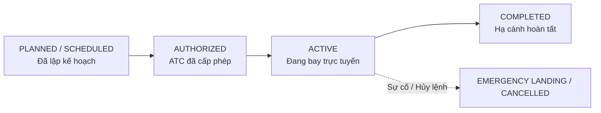

# 03. Lập Kế Hoạch Nhiệm Vụ & Phê Duyệt Chuyến Bay

> [← Hạ tầng & Đội tàu bay](02-ha-tang-va-doi-tau.md) | [Mục lục](README.md) | [Tiếp theo: Giám sát & Điều hành trực tuyến →](04-giam-sat-va-dieu-hanh-truc-tuyen.md)

Hệ thống hỗ trợ 2 cách khởi tạo hành trình bay: **tạo kịch bản nhiệm vụ tái sử dụng (`Missions`)** hoặc **đăng ký trực tiếp một chuyến bay cụ thể (`Flights`)**.

---

## 1. Thiết kế Nhiệm vụ Bay (`Missions`)

**Đường dẫn**: `Planning & Assets` → **Missions** (`/dashboard/missions`)

Phù hợp cho các tuyến bay tuần tra, khảo sát hoặc vận chuyển lặp lại nhiều lần.

### Các bước tạo nhiệm vụ mới

1. Nhấn **+ New Mission** để mở giao diện thiết kế chia đôi (Bản đồ bên trái — Biểu mẫu bên phải).
2. **Tab `Details`**: Nhập tên nhiệm vụ, chọn trạm xuất phát (`Departure Hub`), trạm đích (`Arrival Hub`) và độ cao hành trình mặc định (`Cruising Altitude`).
3. **Vẽ lộ trình trên bản đồ**:
   - Đảm bảo nút **`+ Add Point`** trên thanh công cụ bản đồ đang bật, sau đó nhấp lần lượt lên bản đồ để đặt các điểm mốc (**Waypoints**).
   - Bật nút **`Zones`** góc trên bản đồ để hiện toàn bộ vùng cấm/hành lang bay xung quanh khi căn chỉnh đường bay.
   - Chuyển sang chế độ **`Select`** để nắm kéo vị trí Waypoint bất kỳ, hoặc dùng **`Undo` / `Clear`** để hoàn tác.
   - Chuyển sang **Tab `Waypoints`** ở cột phải nếu cần chỉnh chính xác cao độ từng điểm mốc.
4. **Kiểm tra mặt cắt độ cao (`Altitude Profile`)**:
   - Biểu đồ dưới chân bản đồ tự động tính tổng quãng đường (`DISTANCE`), trần bay (`CEILING`) và vẽ các khối màu vùng trời nơi tuyến bay đi ngang qua.
   - Nếu xuất hiện cảnh báo đỏ **`ZONE PENETRATION`**, lộ trình đang cắt vào vùng cấm/hạn chế ở độ cao vi phạm — hãy kéo điểm mốc vòng qua hoặc điều chỉnh cao độ cho đến khi hết cảnh báo.
5. Nhấn **Save Mission** để lưu bản nháp (`DRAFT`).

### Triển khai nhiệm vụ thành chuyến bay

Trên bảng danh sách **Missions**, sử dụng menu thao tác trên dòng nhiệm vụ:

- **Schedule**: Chuyển nhiệm vụ từ bản nháp sang trạng thái sẵn sàng điều phái (`SCHEDULED`).
- **Execute**: Chọn tàu bay (`Drone`) và phi công phụ trách để hệ thống tự động sinh kế hoạch chuyến bay (`Flight`) tương ứng.
- **Duplicate**: Nhân bản nhanh thành một nhiệm vụ mới để tinh chỉnh.

---

## 2. Đăng ký Chuyến bay Trực tiếp (`Flights`)

**Đường dẫn**: `Planning & Assets` → **Flights** (`/dashboard/flights` → **+ Register Flight**)

1. **Tab `Details`**:
   - Mã hiệu chuyến bay (`Flight Number`) mặc định tự sinh qua công tắc **AUTO-GEN** (có thể tắt để nhập tay).
   - Chọn **Assigned Drone** (ưu tiên phương tiện đang `AVAILABLE`), **Departure Vertiport**, **Arrival Vertiport**, mã phi công và độ cao hành trình (`Cruising Alt.`).
   - Quan sát hộp **Route Feasibility** ở góc dưới phải: hệ thống tự động ước tính quãng đường, thời gian bay, mức tiêu hao năng lượng (`Wh`) và biên độ pin dự phòng (`FEASIBLE` / `MARGINAL` / `NO GO`).
2. **Vẽ/chỉnh Waypoints & Kiểm tra `Altitude Profile`**: Thao tác tương tự màn hình `Missions` để đảm bảo lộ trình không xuyên vùng cấm.
3. **Tab `Schedule`**: Thiết lập thời điểm dự kiến cất cánh (`Scheduled Departure`) và hạ cánh (`Scheduled Arrival`).
4. Nhấn **Save Flight** để hoàn tất đăng ký.

---

## 3. Thẩm định, Cấp phép ATC & Khởi hành

Một chuyến bay đi qua vòng đời kiểm soát an toàn chặt chẽ trên bảng **Flights** (`/dashboard/flights`):

1. **Xem hồ sơ an toàn trước bay (`Briefing`)**: Nhấp hành động xem **Pre-Flight Briefing** trên chuyến bay để rà soát tổng hợp thời tiết trạm đi/đến, vùng trời giao cắt, xung đột dự kiến và mức an toàn năng lượng.
2. **Cấp phép không lưu (`Authorize` — dành cho `ATC` hoặc `Admin`)**: Sau khi kiểm tra đạt yêu cầu, kiểm soát viên nhấn **Authorize** để cấp huấn lệnh bay hợp lệ.
3. **Bắt đầu chuyến bay (`Start`)**: Đến giờ khởi hành, nhấn **Start** để chuyển chuyến bay sang trạng thái `ACTIVE` và kích hoạt giám sát hành lang thời gian thực.
4. **Kết thúc hoặc Hủy khẩn (`Complete` / `Abort`)**: Đóng chuyến bay sau khi tàu bay đáp an toàn xuống Vertiport đích, hoặc nhấn **Abort** để hủy kế hoạch khi có bất thường.
