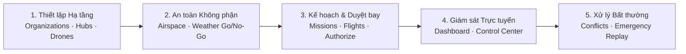

# Hướng Dẫn Sử Dụng Hệ Thống Quản Lý Bay Không Người Lái (UTM Backoffice)

Bộ tài liệu hướng dẫn vận hành giao diện điều hành trung tâm **UTM Backoffice** dành cho Quản trị viên, Kiểm soát viên không lưu (ATC), Điều hành viên bãi đáp (Hub Operator) và Phi công từ xa (Pilot).

---

## 1. Quy trình Vận hành Chuẩn (5 Bước)

1. **Thiết lập hạ tầng**: Khai báo đơn vị khai thác (`Organizations`), bãi cất/hạ cánh (`Hubs`), tàu bay (`Drones`) và kết nối thiết bị (`Connectivity`).
2. **Kiểm tra không phận & thời tiết**: Thiết lập vùng cấm/hành lang bay (`Airspace`) và tra cứu điều kiện `Go / No-Go` tại `Weather & AIS`.
3. **Lập kế hoạch & phê duyệt**: Vẽ lộ trình bay trên `Missions` hoặc `Flights`, kiểm tra năng lượng pin (`Feasibility`) và trình `ATC` phê duyệt (`Authorize`).
4. **Điều hành trực tuyến**: Giám sát viễn trắc thời gian thực, dự báo sớm `4D Foresight` trên `Dashboard` và gửi lệnh điều khiển từ xa tại `Control Center` (hoặc bay thử trên `Simulation`).
5. **Ứng phó an toàn**: Giải tỏa mất phân cách tại `Conflicts` và xử lý sự cố / xem lại hộp đen hành trình tại `Emergency`.

---

## 2. Phân quyền Theo Vai trò (RBAC)

Hệ thống xác thực tập trung qua cổng SSO (Keycloak OAuth2) và tự động hiển thị chức năng theo vai trò tài khoản:

| Quyền thao tác chính                                               |  `Admin`  |   `ATC`   | `Hub Operator` | `Pilot` |
| ------------------------------------------------------------------ | :-------: | :-------: | :------------: | :-----: |
| Xem bản đồ, chuyến bay, thời tiết, cảnh báo                        |    Có     |    Có     |       Có       |   Có    |
| Lập nhiệm vụ (`Missions`) & đăng ký chuyến bay (`Flights`)         |    Có     |    Có     |       Có       |   Có    |
| Phê duyệt / từ chối kế hoạch bay (`Authorize Flight`)              |    Có     |    Có     |       —        |    —    |
| Giải tỏa xung đột (`Conflicts`) & cấu hình cứu nạn (`Emergency`)   |    Có     |    Có     |       —        |    —    |
| Tạo / xóa vùng trời (`Airspace`)                                   | Tạo / Xóa | Tạo / Xóa |      Tạo       |    —    |
| Đăng ký / cập nhật tàu bay (`Drones`) & chỉnh sửa `Hubs`           |    Có     |     —     |       Có       |    —    |
| Điều phối & cân bằng tải đội bay (`Fleet`)                         |    Có     |     —     |       Có       |    —    |
| Quản lý tổ chức (`Organizations`), tạo/xóa `Hub`, khóa `Developer` |    Có     |     —     |       —        |    —    |

> **Kiểm tra quyền cá nhân**: Truy cập mục **Settings** ở góc dưới thanh menu trái để xem chi tiết hồ sơ và danh sách quyền hiện hành của tài khoản.

---

## 3. Danh mục Tài liệu Hướng dẫn

| Tài liệu                                                                              | Nội dung trọng tâm                                                                                    | Đối tượng chính                |
| ------------------------------------------------------------------------------------- | ----------------------------------------------------------------------------------------------------- | ------------------------------ |
| **[01. Bản đồ 3D/2D & Giao diện chung](01-ban-do-va-giao-dien-chung.md)**             | Thao tác bản đồ Cesium 3D/2D, 5 lớp nền, la bàn, thước tỷ lệ, trợ lý AI Copilot & Settings            | Tất cả vai trò                 |
| **[02. Hạ tầng & Đội tàu bay](02-ha-tang-va-doi-tau.md)**                             | Quản lý `Organizations`, `Hubs`, `Drones`, chứng thư kết nối `Connectivity` & cân bằng tải `Fleet`    | `Admin`, `Hub Operator`        |
| **[03. Lập kế hoạch & Phê duyệt bay](03-lap-ke-hoach-va-duyet-bay.md)**               | Soạn thảo `Missions`, đăng ký `Flights`, mặt cắt độ cao vùng trời, thẩm định pin & duyệt bay ATC      | `Pilot`, `Hub Operator`, `ATC` |
| **[04. Giám sát & Điều hành trực tuyến](04-giam-sat-va-dieu-hanh-truc-tuyen.md)**     | Vận hành `Dashboard`, dự báo `4D Foresight`, bảng lệnh C2 tại `Control Center` & giả lập `Simulation` | Tất cả vai trò                 |
| **[05. An toàn Không phận & Khẩn cấp](05-an-toan-khong-phan-va-ung-pho-khan-cap.md)** | Vẽ vùng trời `Airspace`, tra cứu `Weather & AIS`, giải tỏa `Conflicts` & cứu nạn `Emergency`          | `ATC`, `Admin`, `Hub Operator` |
| **[06. Tích hợp Thiết bị OEM & Developer](06-tich-hop-oem-va-developer.md)**          | Cấp phát `API Keys`, thử nghiệm `API Playground`, tải chứng chỉ `Root CA` & tra cứu Swagger           | `Admin`, Kỹ sư tích hợp        |

---

> Tài liệu đặc tả kỹ thuật REST API và cơ sở dữ liệu dành cho lập trình viên được đặt riêng tại [`docs/api/README.md`](../api/README.md).
